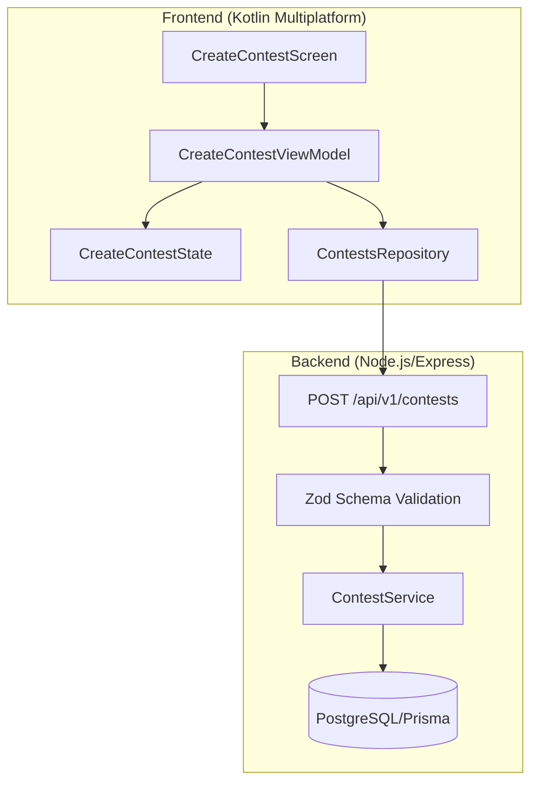
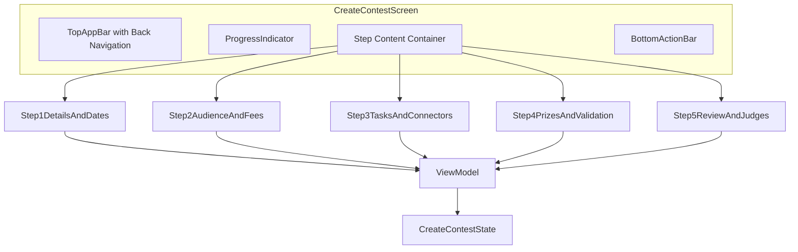

# Design Document: Contest Creation Wizard

## Overview

The Contest Creation Wizard is a comprehensive 5-step form interface for creating parent contests with team participation options in the Krieta mobile application. This design document outlines the technical architecture, component structure, state management, data models, and integration points required to implement all 16 requirements specified in the requirements document.

### Key Features

- **5-Step Wizard Flow**: Details & Dates → Audience & Fees → Tasks & Connectors → Prizes & Validation → Review & Judges
- **Team Participation Support**: Individual-only, team-only, and hybrid participation modes
- **Real-Time Validation**: Per-step validation with immediate user feedback
- **Native Date/Time Pickers**: Platform-specific date selection UI
- **Real-Time Kr Conversion**: Live currency conversion display
- **Judge Assignment**: Search and assign up to 15 judges for manual/combination selection
- **Comprehensive Review**: Final review screen showing all configured settings

### Technology Stack

- **Frontend**: Kotlin Multiplatform (Compose Multiplatform)
- **State Management**: Kotlin StateFlow
- **Navigation**: Voyager
- **Backend**: Node.js/Express with Prisma ORM
- **Database**: PostgreSQL

## Architecture

### High-Level Architecture



### Component Architecture

The wizard follows a single-screen, multi-step pattern where the UI dynamically renders different content based on the current step while maintaining a consistent layout structure.



### State Management Flow

```mermaid
sequenceDiagram
    participant UI as CreateContestScreen
    participant VM as CreateContestViewModel
    participant State as CreateContestState
    participant Repo as ContestsRepository
    participant API as Backend API
    
    UI->>VM: User Input (updateTitle, etc.)
    VM->>State: Update State
    State-->>UI: Emit New State
    
    UI->>VM: nextStep()
    VM->>VM: validateCurrentStep()
    alt Valid
        VM->>State: currentStep++
        State-->>UI: Render Next Step
    else Invalid
        VM->>State: Set Validation Errors
        State-->>UI: Show Errors
    end
    
    UI->>VM: publishContest()
    VM->>VM: validateAllSteps()
    VM->>Repo: createContest(payload)
    Repo->>API: POST /api/v1/contests
    API-->>Repo: Contest Created
    Repo-->>VM: Success/Error
    VM->>State: Update State
    State-->>UI: Show Success/Error
