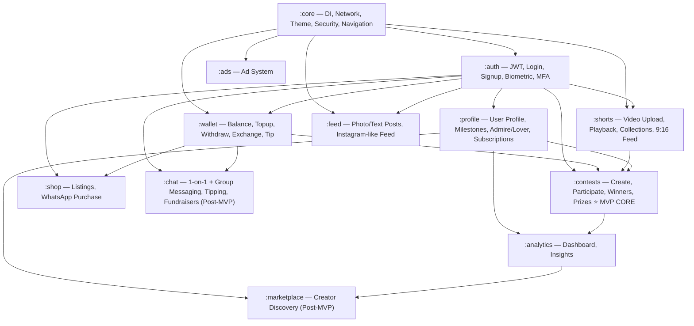
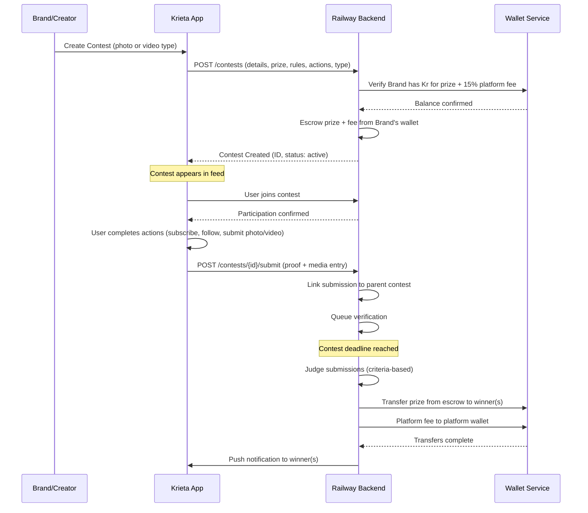

# Krieta — Full Implementation Plan (v2)

> **Creator-centric marketing engine** — KMP + Compose Multiplatform (Android-first, iOS-second)
> Railway Backend (Node.js + TypeScript) · Custom JWT · Server-side Payments · Cloudinary Media

---

## User Review Required

> [!IMPORTANT]
> **Contests are the core MVP feature.** The module order is dependency-driven — we must build Core → Auth → Wallet before Contests can function (contests need users, authentication, and Kr transactions). However, Contests will receive the most design attention and will be the first "feature" module fully wired end-to-end.

> [!WARNING]
> **Chat and Creator Marketplace are planned but deferred to post-MVP.** They are included in the architecture to ensure extensibility, but not in the initial build. Chat architecture is now expanded to include: 1-on-1 tipping/tip requests, group fundraisers with fund managers and transparent group wallets.

> [!IMPORTANT]
> **Video size recommendation:** Industry standard for 3-min 9:16 shorts at 1080×1920:
> - **Codec**: H.264 (AAC audio)
> - **Bitrate**: 4–6 Mbps video, 128 kbps audio
> - **Max file size**: ~150 MB (hard limit), target ~80–100 MB after client-side compression
> - **Cloudinary** handles transcoding/adaptive bitrate on upload — we send the original and Cloudinary serves optimized versions
> - **Client-side**: Compress before upload using platform-native (Android MediaCodec / iOS AVAssetExportSession) via expect/actual
> - **Cloudinary folder structure**: `Krieta/{module}/{mediaType}` (e.g., `Krieta/contests/video`, `Krieta/profile/photo`) — never mix media types

---

## Critical Business Rules (Global)

### Kr Currency Display (EVERYWHERE)

```
✅ Kr.500 (~KES 850)     — symbol DOT amount, fiat in parentheses
✅ Kr.1                   — dot between symbol and amount
✅ Kr.0.50                — decimals allowed
❌ 500 Kr                 — NEVER amount then symbol
❌ Kr 500                 — NEVER space between symbol and amount
❌ Kr500                  — NEVER without dot
```

- **Every** Kr amount displayed in the app MUST show the user's location-based fiat currency conversion below/beside it
- Applies to: Wallet, Shop, Milestones, Contests, Tips, Profile earnings, Analytics, Transaction history, Subscription tiers
- **Input fields**: User always enters amount in their local fiat currency. Real-time Kr conversion displayed as they type
- Fiat rate refreshed at: app launch, wallet access, wallet pull-to-refresh

### Account Types (Permanent)

| Type | Set At | Can Change? | Capabilities |
|------|--------|-------------|--------------|
| **Personal** | Signup | ❌ Never | Browse, participate, tip, shop |
| **Creator** | Signup | ❌ Never | All Personal + Create contests, create shorts, analytics, receive subscriptions |
| **Business** | Signup | ❌ Never | All Creator + Brand tools, marketplace access, bulk contest creation |

### Identity & Wallet Lock Rules

1. **Real names required**: User MUST enter their legal name as on government-issued document (passport, driving licence)
2. **Explicit warning on signup**: "Your name and username cannot be changed after your wallet is unlocked. Use your real name as it appears on your government-issued ID. This is for accountability and security purposes."
3. **Wallet unlock trigger**: First time ANY Kr enters the wallet (topup, tip received, shop sale, brand payment, ad revenue, contest prize)
4. **After wallet unlock**: Username and display name fields become permanently read-only
5. **Before wallet unlock**: User can edit username and display name freely
6. **Backend enforces**: `is_wallet_unlocked` flag on user record, checked on every profile update request

### Admire / Lover System

```
State A → B         |  State B → A         |  Button A sees on B's profile  |  Button B sees on A's profile
---------------------|----------------------|-------------------------------|-------------------------------
A admires B          |  B does NOT admire A |  "Unadmire"                   |  "Admire"
A does NOT admire B  |  B admires A         |  "Admire"                     |  "Unadmire"
A admires B          |  B admires A         |  "Unlove" (they are Lovers 💕)|  "Unlove" (they are Lovers 💕)
Neither admires      |  Neither admires     |  "Admire"                     |  "Admire"
```

- **Mutual admiration = Lovers** — backend detects mutual admires and sets `is_lovers` flag
- When either party Unloves, the relationship drops to one-way admire (the unlover no longer admires, but the other still does)
- Lover status visible on profile with a subtle badge/indicator

### Tipping Rules

| Context | Can Tip? | Notes |
|---------|----------|-------|
| **Posts (Feed)** | ✅ Yes | Tip button on unlocked posts |
| **Shorts** | ✅ Yes | Tip button overlay on unlocked shorts |
| **Contests** | ❌ No | No tipping on contest entries |
| **Locked content** | ❌ No tip button | Must subscribe to access, no tip on locked content |
| **Wallet (search)** | ✅ Yes | Search user → Enter amount in local fiat → Live Kr conversion → Confirm prompt |
| **1-on-1 Chat** | ✅ Yes (Post-MVP) | Tip + request tip in DMs |
| **Group Chat** | ❌ No tips | Fundraiser system instead (Post-MVP) |

**Wallet tip confirmation prompt:**
```
You are about to tip
@username (Full Name)
Kr.50 (~KES 85)

[CANCEL]  [TIP]
```

### Locked Content & Subscription Tiers

Creators can lock posts/shorts behind subscription tiers. Users must subscribe to a creator's tier to access that locked content.

**Subscription Tiers** (creator-defined):
| Tier | Default Order | Creator Customizable |
|------|---------------|---------------------|
| **Top Fun** | Tier 1 (lowest) | Custom Kr amount, custom benefits description |
| **Real Fan** | Tier 2 | Custom Kr amount, custom benefits description |
| **True Fan** | Tier 3 | Custom Kr amount, custom benefits description |
| **Super Fan** | Tier 4 (highest) | Custom Kr amount, custom benefits description |

- Creator can enable 1, 2, 3, or all 4 tiers
- Each tier has a custom monthly Kr amount set by the creator
- Each tier has a creator-written benefits description
- Higher tiers automatically include access to all lower tier content
- **Platform fee: 15% per subscription** (deducted from creator's received amount)
- Locked content shows a paywall overlay with tier requirement
- Locked content does NOT show a tip button

### Contest Platform Fee

- **15% platform fee** calculated and deducted at contest creation time
- Creator enters prize pool → Platform adds 15% → Total charged from wallet = Prize + 15% fee
- Example: Creator sets Kr.100 prize → Platform fee Kr.15 → Total escrowed: Kr.115 → Winners receive Kr.100 total
- Fee is shown transparently in the contest creation flow

### Contest Types

- Contests can be **photo contests** OR **video contests** (or both)
- Photo contests: Participants submit photos as proof/entries
- Video contests: Participants submit 9:16 shorts as entries
- All submissions (entries) are always linked to their parent contest
- Parent contest page shows ALL entries (active or ended contests)

### Shorts Collections / Series

- User can upload shorts as **standalone** or as part of a **series/collection**
- Standalone uploads go to an automatic "Singles" collection
- User can move a single to an existing collection at any time
- Collections display on user's profile under collection name
- Series maintain order (episode numbering)

### Shorts Playback Rules

- Background music from device allowed (expect/actual for audio engine)
- **Stop current short** when scrolling to next/previous — only one video plays at a time
- Preload adjacent shorts for smooth transitions
- Correct audio track plays with correct short (no audio leakage between shorts)
- Smooth 60fps playback, no lag

### Cloudinary Folder Structure

```
Krieta/
├── profile/
│   ├── photo/       ← Avatars, cover photos
│   └── video/       ← Profile videos (if any)
├── shorts/
│   ├── video/       ← Short-form videos
│   └── photo/       ← Thumbnails
├── contests/
│   ├── photo/       ← Contest cover images, photo submissions
│   └── video/       ← Video submissions, contest promos
├── feed/
│   ├── photo/       ← Post images
│   └── video/       ← (future: feed videos)
├── shop/
│   └── photo/       ← Product images
└── chat/            ← (Post-MVP)
    ├── photo/
    ├── video/
    └── audio/       ← Voice notes
```

**NEVER mix**: photos with videos, audio with video/photos. Each media type in its own folder under its module.

---

## Architecture Overview

### Module Dependency Graph



### KMP Source Set Strategy

```
composeApp/src/
├── commonMain/kotlin/com/krieta/     ← 85% of code lives here
│   ├── core/
│   ├── feature/auth/
│   ├── feature/wallet/
│   ├── feature/profile/
│   ├── feature/shorts/
│   ├── feature/feed/
│   ├── feature/contests/
│   ├── feature/shop/
│   ├── feature/analytics/
│   └── feature/ads/
├── androidMain/kotlin/com/krieta/    ← Android-specific (ExoPlayer, Location, Biometric)
└── iosMain/kotlin/com/krieta/        ← iOS-specific (AVPlayer, CLLocation, LocalAuth)
```

Each feature module follows **Clean Architecture** internally:

```
feature/{module}/
├── data/
│   ├── remote/          ← Ktor API service, DTOs
│   ├── local/           ← SQLDelight DAOs, DataStore cache
│   └── repository/      ← Repository implementations
├── domain/
│   ├── model/           ← Domain models (pure Kotlin)
│   ├── repository/      ← Repository interfaces
│   └── usecase/         ← Business logic use cases
└── presentation/
    ├── screen/          ← Compose screens
    ├── component/       ← Reusable UI components
    └── viewmodel/       ← ViewModels (Lifecycle-aware)
```

### Backend Architecture (Railway — Node.js + TypeScript)

```
backend/
├── src/
│   ├── config/           ← DB, Redis, env, Cloudinary config
│   ├── middleware/        ← Auth JWT, rate limiting, HMAC validation, error handler
│   ├── modules/
│   │   ├── auth/         ← Register, Login, Token refresh, MFA
│   │   ├── user/         ← Profile, Milestones, Admire/Lover, Subscriptions
│   │   ├── wallet/       ← Balance, Topup, Withdraw, Exchange rates, Tip
│   │   ├── shorts/       ← Video metadata, collections, feed queries
│   │   ├── feed/         ← Photo/text posts, likes, comments
│   │   ├── contests/     ← Contest CRUD, participation, judging, prizes
│   │   ├── shop/         ← Product listings, seller management
│   │   ├── analytics/    ← Aggregation, insights
│   │   └── ads/          ← Ad serving, impressions, clicks
│   ├── services/
│   │   ├── payment/      ← PayPal, Paystack, M-Pesa, Payoneer (server-side only)
│   │   ├── exchange/     ← Fawaz Ahmed currency API integration
│   │   ├── cloudinary/   ← Upload signatures, webhook handler, folder routing
│   │   └── notification/ ← Push notifications (FCM/APNs)
│   └── utils/            ← Helpers, validators, crypto
├── prisma/
│   └── schema.prisma     ← PostgreSQL schema
├── package.json
├── tsconfig.json
└── Dockerfile            ← Railway deployment
```

**Tech stack (Backend):**
- **Runtime**: Node.js 22 + TypeScript (type safety critical for financial ops)
- **Framework**: Express.js (lightweight, battle-tested)
- **ORM**: Prisma (PostgreSQL)
- **Cache**: Redis (via Railway add-on) — feeds, leaderboards, rate limiting, exchange rates
- **Auth**: bcrypt + JWT (access + refresh tokens)
- **Validation**: Zod
- **File uploads**: Cloudinary SDK (server-side signed uploads with folder routing)
- **Payments**: Server-side SDKs (PayPal REST, Paystack, M-Pesa Daraja, Payoneer)
- **WebSockets**: Socket.io (milestone race notifications, real-time contest updates)
- **Queue**: BullMQ + Redis (background jobs: exchange rate refresh, payout processing, judging)

---

## Phase-by-Phase Implementation

---

### Phase 1: Core Infrastructure

> Foundation layer — everything depends on this.

#### 1A. [MOBILE] Core Module

##### [MODIFY] [libs.versions.toml](file:///c:/Users/ADMIN/appu/gradle/libs.versions.toml)
- Add versions for: Ktor 3.x, Koin 3.6.x, Voyager 1.1.x, Coil 3.x, SQLDelight 2.x, kotlinx-serialization, kotlinx-datetime, DataStore, ExoPlayer 2.19.x, security-crypto, media3
- Add version catalog entries for all libraries

##### [MODIFY] [build.gradle.kts (composeApp)](file:///c:/Users/ADMIN/appu/composeApp/build.gradle.kts)
- Add kotlinx-serialization plugin
- Add SQLDelight plugin
- Add all dependency declarations for commonMain, androidMain, iosMain
- Configure SQLDelight database
- Enable R8 for release builds
- Add signing config placeholder

##### [MODIFY] [settings.gradle.kts](file:///c:/Users/ADMIN/appu/settings.gradle.kts)
- Rename root project to `Krieta`

##### [NEW] `commonMain/com/krieta/core/di/AppModule.kt`
- Root Koin module aggregating all feature modules
- Platform-specific module injection via expect/actual

##### [NEW] `commonMain/com/krieta/core/network/KtorClient.kt`
- Ktor HttpClient factory with:
  - ContentNegotiation (JSON with snake_case ↔ camelCase via `JsonNamingStrategy.SnakeCase`)
  - Auth (Bearer token interceptor with auto-refresh on 401)
  - Logging (debug only)
  - Default request (base URL config)
  - Timeout configuration (connect: 15s, request: 30s)
  - Certificate pinning (via expect/actual for platform engines)

##### [NEW] `commonMain/com/krieta/core/network/ApiConstants.kt`
- Base URL (Railway backend), API version prefix
- Endpoint paths as constants (organized by module)

##### [NEW] `commonMain/com/krieta/core/network/NetworkResult.kt`
- Sealed class: `Success<T>`, `Error(code, message)`, `Loading`
- Extension functions for safe API calls with error mapping

##### [NEW] `commonMain/com/krieta/core/navigation/AppNavigator.kt`
- Voyager Tab-based navigation (Home, Discover, Contests, Shop, Profile)
- Nested stack navigation within each tab
- Deep link support

##### [NEW] `commonMain/com/krieta/core/theme/KrietaTheme.kt`
- Material3 dark/light theme
- Custom color palette (premium feel, NO purple per GEMINI.md rules)
- Typography (Inter/Outfit via Google Fonts)
- Shape system, elevation, spacing tokens

##### [NEW] `commonMain/com/krieta/core/theme/Colors.kt`
- Curated color palette — dark-mode-first
- Primary: Deep teal/emerald green
- Accent: Warm gold/amber
- Surface: Rich dark grays
- Status colors (success, error, warning)

##### [NEW] `commonMain/com/krieta/core/security/TokenManager.kt`
- `expect class TokenManager` — stores access/refresh tokens
- Android: EncryptedSharedPreferences + Android Keystore
- iOS: Keychain Services

##### [NEW] `commonMain/com/krieta/core/security/DeviceSecurity.kt`
- `expect class DeviceSecurity`
- Android: Root detection (RootBeer), emulator detection, SafetyNet/Play Integrity
- iOS: Jailbreak detection, debug detection

##### [NEW] `commonMain/com/krieta/core/location/LocationProvider.kt`
- `expect class LocationProvider`
- `getCurrentCountry(): String` — ISO country code ("KE", "NG", "US")
- `getCurrentCurrency(): String` — currency code ("KES", "NGN", "USD")
- Android: `Locale.getDefault()` + GPS fallback via FusedLocationProvider
- iOS: `Locale.current` + CLLocationManager fallback

##### [NEW] `commonMain/com/krieta/core/location/CurrencyMapper.kt`
- Country code → Currency code mapping (ISO 4217 complete table)
- Cache in DataStore, refresh on app launch

##### [NEW] `commonMain/com/krieta/core/datastore/PreferencesManager.kt`
- `expect class PreferencesManager`
- Wrapper around DataStore for: detected currency, theme preference, user session cache
- Android: AndroidX DataStore
- iOS: NSUserDefaults DataStore

##### [NEW] `commonMain/com/krieta/core/database/KrietaDatabase.kt`
- SQLDelight database definition
- Tables for offline cache: users, wallet_cache, feed_cache, contest_cache, shorts_cache

##### [NEW] `commonMain/com/krieta/core/util/KrCurrencyFormatter.kt`
- Format `Kr.{amount}` — always symbol DOT amount, no space
- Format with fiat: `Kr.500 (~KES 850)` 
- Input conversion: fiat amount → Kr.{converted} as user types
- Handle decimal precision per currency
- Handle rounding rules

##### [NEW] `commonMain/com/krieta/core/util/DateTimeUtil.kt`
- kotlinx-datetime helpers for contest deadlines, timestamps

##### [NEW] `commonMain/com/krieta/core/ui/components/`
- `KrietaTopBar.kt` — App bar with consistent styling
- `KrietaBottomBar.kt` — Bottom navigation (5 tabs)
- `LoadingIndicator.kt` — Branded loading spinner
- `ErrorState.kt` — Error display with retry button
- `EmptyState.kt` — Empty content placeholder
- `KrAmountDisplay.kt` — Kr.{amount} + fiat conversion display (reused EVERYWHERE)
- `KrAmountInput.kt` — Fiat input → live Kr.{amount} conversion as user types
- `TipConfirmDialog.kt` — "You are about to tip @username (Full Name) Kr.{amount} (~{fiat}) [CANCEL] [TIP]"
- `ContentPaywall.kt` — Subscription tier paywall overlay for locked content
- `IdentityLockBanner.kt` — Warning banner: "Name/username locked after wallet activation"

##### [MODIFY] `commonMain/com/krieta/com/App.kt`
- Replace template content with Koin initialization + Voyager navigator + KrietaTheme

##### [NEW] `androidMain/com/krieta/core/di/PlatformModule.android.kt`
- Android-specific Koin bindings (Context, ExoPlayer, Location)

##### [NEW] `iosMain/com/krieta/core/di/PlatformModule.ios.kt`
- iOS-specific Koin bindings

##### [MODIFY] `androidMain/com/krieta/com/MainActivity.kt`
- Initialize Koin in Application class
- Handle edge-to-edge display, safe areas

##### [NEW] `androidMain/com/krieta/com/KrietaApplication.kt`
- Application class with Koin startup

##### [MODIFY] `androidMain/AndroidManifest.xml`
- Add permissions: INTERNET, ACCESS_FINE_LOCATION, ACCESS_COARSE_LOCATION, CAMERA, READ_EXTERNAL_STORAGE, READ_MEDIA_VIDEO, READ_MEDIA_IMAGES
- Add `KrietaApplication` as application class
- Add `usesCleartextTraffic="false"`
- Add network security config

##### [NEW] `androidMain/res/xml/network_security_config.xml`
- Certificate pinning rules
- Disable cleartext traffic

#### 1B. [BACKEND] Core Infrastructure

##### [NEW] `backend/package.json`
- Dependencies: express, prisma, @prisma/client, jsonwebtoken, bcrypt, zod, socket.io, bullmq, ioredis, cors, helmet, express-rate-limit, cloudinary, axios, uuid, multer

##### [NEW] `backend/tsconfig.json`
- Strict TypeScript config with `strict: true`, `noImplicitAny: true`

##### [NEW] `backend/src/index.ts`
- Express server setup with middleware chain
- Socket.io initialization
- Graceful shutdown

##### [NEW] `backend/src/config/database.ts`
- Prisma client singleton

##### [NEW] `backend/src/config/redis.ts`
- Redis connection (Railway add-on URL)

##### [NEW] `backend/src/config/env.ts`
- Environment variable validation with Zod

##### [NEW] `backend/src/config/cloudinary.ts`
- Cloudinary config + folder path constants:
  ```typescript
  export const CLOUDINARY_FOLDERS = {
    PROFILE_PHOTO: 'Krieta/profile/photo',
    PROFILE_VIDEO: 'Krieta/profile/video',
    SHORTS_VIDEO: 'Krieta/shorts/video',
    SHORTS_PHOTO: 'Krieta/shorts/photo',
    CONTESTS_PHOTO: 'Krieta/contests/photo',
    CONTESTS_VIDEO: 'Krieta/contests/video',
    FEED_PHOTO: 'Krieta/feed/photo',
    SHOP_PHOTO: 'Krieta/shop/photo',
    CHAT_PHOTO: 'Krieta/chat/photo',
    CHAT_VIDEO: 'Krieta/chat/video',
    CHAT_AUDIO: 'Krieta/chat/audio',
  } as const;
  ```

##### [NEW] `backend/src/middleware/auth.ts`
- JWT verification middleware
- Token refresh logic
- HMAC request signature validation

##### [NEW] `backend/src/middleware/rateLimiter.ts`
- Redis-based rate limiting per endpoint category

##### [NEW] `backend/src/middleware/errorHandler.ts`
- Global error handler with structured error responses

##### [NEW] `backend/Dockerfile`
- Multi-stage Docker build for Railway deployment

##### [NEW] `backend/prisma/schema.prisma`
- Full PostgreSQL schema (see Schema section below)

##### [NEW] `backend/.env.example`
- Template for all required environment variables

---

### Phase 2: Auth Module

> Custom JWT authentication with biometric unlock, MFA, and account type permanence.

#### 2A. [MOBILE] Auth Feature

##### [NEW] `commonMain/com/krieta/feature/auth/data/remote/AuthApi.kt`
- Ktor endpoints: `/auth/register`, `/auth/login`, `/auth/refresh`, `/auth/verify-otp`, `/auth/logout`

##### [NEW] `commonMain/com/krieta/feature/auth/data/remote/dto/`
- `LoginRequestDto.kt`, `RegisterRequestDto.kt`, `AuthResponseDto.kt`, `RefreshTokenDto.kt`
- All DTOs use kotlinx.serialization with `@SerialName` for snake_case mapping

##### [NEW] `commonMain/com/krieta/feature/auth/data/repository/AuthRepositoryImpl.kt`
- Implements AuthRepository interface
- Handles token storage via TokenManager
- Manages auth state flow

##### [NEW] `commonMain/com/krieta/feature/auth/domain/model/User.kt`
- Domain model: id, username, displayName, firstName, lastName, email, phone, avatarUrl, bio, country, currency, accountType (PERSONAL/CREATOR/BUSINESS), isVerified, isWalletUnlocked, createdAt

##### [NEW] `commonMain/com/krieta/feature/auth/domain/repository/AuthRepository.kt`
- Interface: login, register, refreshToken, logout, getCurrentUser, isAuthenticated

##### [NEW] `commonMain/com/krieta/feature/auth/domain/usecase/`
- `LoginUseCase.kt`, `RegisterUseCase.kt`, `RefreshTokenUseCase.kt`, `ValidateInputUseCase.kt`

##### [NEW] `commonMain/com/krieta/feature/auth/presentation/viewmodel/AuthViewModel.kt`
- Login/Register state management
- Form validation (real name validation)
- Auth state observation
- Account type selection state

##### [NEW] `commonMain/com/krieta/feature/auth/presentation/screen/LoginScreen.kt`
- Email/phone + password login
- Biometric unlock option
- "Sign up" navigation
- Premium design with gradient background, glassmorphism cards

##### [NEW] `commonMain/com/krieta/feature/auth/presentation/screen/RegisterScreen.kt`
- **Step-by-step registration**:
  1. **Account Type**: Personal / Creator / Business — with explicit warning: "Account type cannot be changed later"
  2. **Full Name**: First name + Last name — with notice: "Use your legal name as on your government-issued ID (passport, driving licence). Your name and username will be permanently locked once your wallet is activated."
  3. **Username**: Unique username — with same lock warning
  4. **Email + Password**
  5. **Phone (optional)** + OTP verification
  6. **Terms acceptance** (including identity lock acknowledgment)

##### [NEW] `commonMain/com/krieta/feature/auth/presentation/screen/BiometricSetupScreen.kt`
- Biometric enrollment prompt after first login

##### [NEW] `commonMain/com/krieta/feature/auth/di/AuthModule.kt`
- Koin module for auth dependencies

##### [NEW] `androidMain/com/krieta/feature/auth/BiometricAuthManager.android.kt`
- AndroidX Biometric API implementation

##### [NEW] `iosMain/com/krieta/feature/auth/BiometricAuthManager.ios.kt`
- iOS LocalAuthentication framework

#### 2B. [BACKEND] Auth Module

##### [NEW] `backend/src/modules/auth/auth.routes.ts`
- POST `/auth/register` — Create account (includes account_type, first_name, last_name)
- POST `/auth/login` — Login (returns access + refresh tokens)
- POST `/auth/refresh` — Refresh access token
- POST `/auth/verify-otp` — Verify phone/email OTP
- POST `/auth/logout` — Invalidate refresh token
- POST `/auth/biometric` — Register biometric credential

##### [NEW] `backend/src/modules/auth/auth.controller.ts`
- Request validation, response formatting

##### [NEW] `backend/src/modules/auth/auth.service.ts`
- bcrypt password hashing (12 rounds)
- JWT generation (15min access, 7d refresh)
- OTP generation and verification
- Refresh token rotation (single-use refresh tokens)
- Device binding
- **Account type enforcement**: Set once at registration, no update endpoint
- **Wallet lock check**: `is_wallet_unlocked` flag, set to `true` on first Kr credit

##### [NEW] `backend/src/modules/auth/auth.validation.ts`
- Zod schemas for all auth endpoints
- Real name validation (min 2 chars, no numbers/special chars in name fields)
- Account type enum validation

---

### Phase 3: Wallet Module

> Kr platform currency with multi-provider payment integration (all server-side). Wallet activation permanently locks user identity.

#### 3A. [MOBILE] Wallet Feature

##### [NEW] `commonMain/com/krieta/feature/wallet/data/remote/WalletApi.kt`
- GET `/wallet/balance` — Current Kr balance + `is_wallet_unlocked` status
- POST `/wallet/topup/initiate` — Start topup flow (returns provider redirect/reference)
- POST `/wallet/withdraw/initiate` — Start withdrawal
- GET `/wallet/transactions` — Transaction history
- POST `/wallet/tip` — Send tip to user (from wallet search)
- GET `/wallet/exchange-rate?from={currency}&to=kr` — Current rate
- GET `/wallet/search-users?q={query}` — Search users for tipping

##### [NEW] `commonMain/com/krieta/feature/wallet/data/remote/dto/`
- `WalletBalanceDto.kt`, `TopupRequestDto.kt`, `WithdrawRequestDto.kt`, `TransactionDto.kt`, `ExchangeRateDto.kt`, `TipRequestDto.kt`

##### [NEW] `commonMain/com/krieta/feature/wallet/data/local/WalletCacheDao.kt`
- SQLDelight: cached balance, cached transactions (offline display)

##### [NEW] `commonMain/com/krieta/feature/wallet/data/repository/WalletRepositoryImpl.kt`
- Fetches from API, caches locally
- **Balance is ALWAYS server-authoritative** — local is display-only cache
- Refresh on: app launch, wallet access, pull-to-refresh

##### [NEW] `commonMain/com/krieta/feature/wallet/domain/model/`
- `WalletBalance.kt` — krBalance, fiatEquivalent, currency, lastUpdated, isWalletUnlocked
- `Transaction.kt` — id, type (topup/withdraw/tip_sent/tip_received/contest_prize/contest_escrow/subscription_earned/subscription_paid/shop_sale/ad_revenue), amount, currency, status, recipientOrSender, timestamp
- `ExchangeRate.kt` — fromCurrency, toCurrency, rate, marginRate (4.5% platform margin), fetchedAt

##### [NEW] `commonMain/com/krieta/feature/wallet/domain/repository/WalletRepository.kt`

##### [NEW] `commonMain/com/krieta/feature/wallet/domain/usecase/`
- `GetBalanceUseCase.kt` — Fetch balance, format with fiat equivalent using Kr.{amount} format
- `InitiateTopupUseCase.kt` — Determine available providers by country, initiate
- `InitiateWithdrawUseCase.kt` — Validate minimum withdrawal, initiate
- `GetTransactionsUseCase.kt` — Paginated transaction history
- `SearchUsersForTipUseCase.kt` — Real-time user search for tipping
- `SendTipUseCase.kt` — Tip validation, confirmation prompt, and sending
- `GetExchangeRateUseCase.kt` — Live rate with 4.5% margin applied

##### [NEW] `commonMain/com/krieta/feature/wallet/presentation/viewmodel/WalletViewModel.kt`
- Balance state (with fiat conversion in Kr.{amount} (~{fiat}) format)
- Transaction list state
- Topup/Withdraw flow state
- Exchange rate polling
- User search state for tipping

##### [NEW] `commonMain/com/krieta/feature/wallet/presentation/screen/WalletScreen.kt`
- Balance card showing `Kr.{amount}` with fiat equivalent below
- Quick actions: Topup, Withdraw, Tip, History
- Recent transactions list (each showing Kr.{amount} with fiat)
- Screenshot prevention on this screen (secure flag)
- Wallet unlock status indicator

##### [NEW] `commonMain/com/krieta/feature/wallet/presentation/screen/TopupScreen.kt`
- Amount input in local fiat currency
- Live conversion display as user types: "You'll receive Kr.{amount}"
- Payment method selection (based on detected country):
  - 🌍 International: PayPal (card only)
  - 🇰🇪 Kenya: M-Pesa, PayPal
  - 🇳🇬 Nigeria: Paystack, PayPal
  - 🇬🇭 Ghana: Paystack, PayPal
  - Other Paystack-supported: Paystack, PayPal
- Confirmation screen with exchange rate, fee breakdown, PIN/biometric verification
- **First topup warning**: "After this topup, your wallet will be activated and your name/username will be permanently locked."

##### [NEW] `commonMain/com/krieta/feature/wallet/presentation/screen/WithdrawScreen.kt`
- Enter amount in local fiat currency → shows Kr.{equivalent} to deduct
- Withdrawal method (based on country):
  - 🇰🇪 Kenya: M-Pesa
  - 🌍 International: Payoneer
- Minimum withdrawal: Kr.10 (~equivalent)
- Processing time notice
- PIN/biometric verification required

##### [NEW] `commonMain/com/krieta/feature/wallet/presentation/screen/TransactionHistoryScreen.kt`
- Filterable by type (all, topups, withdrawals, tips, prizes, subscriptions, shop, ads)
- Each transaction shows Kr.{amount} with fiat equivalent
- Paginated with pull-to-refresh

##### [NEW] `commonMain/com/krieta/feature/wallet/presentation/screen/TipScreen.kt`
- **Real-time user search** (search by username, display name)
- Shows matching users with avatar, @username, full name
- Enter amount in local fiat currency → real-time Kr.{amount} conversion as they type
- **Confirmation dialog**: "You are about to tip @{username} ({Full Name}) Kr.{amount} (~{fiat equivalent}) [CANCEL] [TIP]"
- PIN/biometric verification after confirm

##### [NEW] `commonMain/com/krieta/feature/wallet/presentation/component/`
- `BalanceCard.kt` — Animated balance display with glassmorphism, shows Kr.{amount} and fiat
- `PaymentMethodCard.kt` — Payment provider selector
- `TransactionItem.kt` — Single transaction row with Kr.{amount} + fiat
- `ExchangeRateBar.kt` — Current rate banner
- `UserSearchResult.kt` — Search result for tip recipient
- `WalletUnlockWarning.kt` — Warning about identity lock on first wallet activation

##### [NEW] `commonMain/com/krieta/feature/wallet/di/WalletModule.kt`

#### 3B. [BACKEND] Wallet Module

##### [NEW] `backend/src/modules/wallet/wallet.routes.ts`
##### [NEW] `backend/src/modules/wallet/wallet.controller.ts`
##### [NEW] `backend/src/modules/wallet/wallet.service.ts`
- **Balance management**: Atomic PostgreSQL transactions for all balance changes
- **Wallet unlock logic**: On first credit (topup webhook, tip received, any Kr income) → Set `is_wallet_unlocked = true` on user record → Lock name/username edits permanently
- **Topup flow**:
  1. App → POST `/wallet/topup/initiate` (amount, currency, provider)
  2. Server validates, creates pending transaction, returns provider-specific data
  3. Provider webhook → Server verifies signature → Credits Kr balance → Triggers wallet unlock if first credit
- **Withdrawal flow**:
  1. App → POST `/wallet/withdraw/initiate` (fiatAmount, provider, destination)
  2. Server converts fiat → Kr at current rate, validates balance, creates pending transaction, queues payout
  3. BullMQ worker processes payout via provider API
  4. On success → Debit Kr balance
- **Tip flow**:
  1. App → POST `/wallet/tip` (recipientId, fiatAmount, currency)
  2. Server converts fiat → Kr, validates sender balance, performs atomic transfer
  3. Creates transaction records for both sender (tip_sent) and recipient (tip_received)
  4. Triggers wallet unlock for recipient if first Kr credit

##### [NEW] `backend/src/services/payment/paypal.service.ts`
- PayPal REST API v2 (Orders API)
- Card payments only (no PayPal wallet)
- Webhook verification

##### [NEW] `backend/src/services/payment/paystack.service.ts`
- Paystack API integration
- Initialize transaction → Return authorization_url
- Webhook verification (IP whitelist + signature)

##### [NEW] `backend/src/services/payment/mpesa.service.ts`
- Safaricom Daraja API v2
- STK Push (topup) — C2B
- B2C (withdrawal)
- Callback URL handling + verification

##### [NEW] `backend/src/services/payment/payoneer.service.ts`
- Payoneer Mass Payouts API
- Payee registration
- Payout submission + status tracking

##### [NEW] `backend/src/services/exchange/exchange.service.ts`
- Fetch rates from: `https://cdn.jsdelivr.net/npm/@fawazahmed0/currency-api@latest/v1/currencies/{base}.json`
- Cache rates in Redis (TTL: 5 minutes)
- Apply 4.5% platform margin (buy rate + 4.5%, sell rate - 4.5%)
- Fallback to cached rate if API is down
- BullMQ scheduled job: refresh popular rates every 5 minutes

---

### Phase 4: Profile + Milestones + Subscriptions Module

> Admire/Lover system, subscription tiers, identity lock.

#### 4A. [MOBILE] Profile Feature

##### [NEW] `commonMain/com/krieta/feature/profile/data/remote/ProfileApi.kt`
- GET `/users/{id}` — User profile (includes relationship status: none/admiring/admired_by/lovers)
- PUT `/users/me` — Update profile (server rejects if wallet unlocked and name/username changed)
- POST `/users/{id}/admire` — Follow (Admire)
- DELETE `/users/{id}/admire` — Unfollow (Unadmire / Unlove)
- GET `/users/{id}/admirers` — Followers list
- GET `/users/{id}/admiring` — Following list
- GET `/users/{id}/lovers` — Mutual admirers list
- GET `/users/me/milestones` — User's milestone progress
- GET `/milestones` — Available milestones
- POST `/users/{id}/subscribe` — Subscribe to a tier
- DELETE `/users/{id}/subscribe` — Unsubscribe
- GET `/users/me/subscription-tiers` — Get my tier config (for creators)
- PUT `/users/me/subscription-tiers` — Update tier config (for creators)
- GET `/users/{id}/subscription-tiers` — Get user's available tiers (for subscribers)

##### [NEW] `commonMain/com/krieta/feature/profile/domain/model/`
- `UserProfile.kt` — Full profile with stats (admirers, admiring, lovers, contests won, Kr earned), accountType, isWalletUnlocked
- `RelationshipStatus.kt` — enum: NONE, ADMIRING, ADMIRED_BY, LOVERS
- `Milestone.kt` — id, title, description, requirement, reward (Kr.{amount} + fiat), isCompleted, completedByUser, progress
- `BioLink.kt` — label, url, icon
- `SubscriptionTier.kt` — tier (TOP_FUN/REAL_FAN/TRUE_FAN/SUPER_FAN), krAmount, fiatEquivalent, benefits description, isEnabled
- `UserSubscription.kt` — subscribedTo, tier, startDate, nextBillingDate

##### [NEW] `commonMain/com/krieta/feature/profile/presentation/screen/ProfileScreen.kt`
- Cover photo + avatar
- Display name, username, bio, bio links
- Account type badge (Creator/Business)
- Stats row: Admirers | Admiring | Lovers | Contests Won
- **Relationship button logic**:
  - Not following → "Admire" button
  - I admire them, they don't → "Unadmire" button
  - They admire me, I don't → "Admire" button
  - Mutual → "Unlove 💕" button
- Subscription tiers section (if creator/business) with subscribe buttons
- Tabs: Posts | Shorts | Collections | Contests | Shop
- Locked content items show paywall with required tier

##### [NEW] `commonMain/com/krieta/feature/profile/presentation/screen/EditProfileScreen.kt`
- Name fields: Editable if `!isWalletUnlocked`, read-only with lock icon if locked
- Username field: Same lock behavior
- Banner: "Name and username permanently locked for accountability and security" (if locked)
- Pre-lock warning: "Your name and username will be permanently locked after your wallet is activated"
- Avatar, cover photo, bio, bio links — always editable

##### [NEW] `commonMain/com/krieta/feature/profile/presentation/screen/MilestonesScreen.kt`
- List of milestones with progress bars
- Completed milestones with checkmark and who completed it first
- Available milestones with progress indicators
- Reward display: Kr.{amount} (~{fiat})

##### [NEW] `commonMain/com/krieta/feature/profile/presentation/screen/SubscriptionTierSetupScreen.kt`
- For creators: Enable/disable tiers (1-4)
- Set custom Kr amount per tier (input in fiat → live Kr conversion)
- Write benefits description per tier
- Preview how it looks to subscribers

##### [NEW] `commonMain/com/krieta/feature/profile/presentation/screen/SubscribersListScreen.kt`
##### [NEW] `commonMain/com/krieta/feature/profile/presentation/screen/AdmirersListScreen.kt`
##### [NEW] `commonMain/com/krieta/feature/profile/presentation/screen/AdmiringListScreen.kt`
##### [NEW] `commonMain/com/krieta/feature/profile/presentation/screen/LoversListScreen.kt`

##### [NEW] `commonMain/com/krieta/feature/profile/presentation/component/`
- `RelationshipButton.kt` — Dynamic Admire/Unadmire/Unlove button with animated state changes
- `SubscriptionTierCard.kt` — Tier display with amount (Kr.{amount} + fiat), benefits, subscribe button
- `LockedContentOverlay.kt` — Paywall with tier info and subscribe CTA
- `IdentityLockIndicator.kt` — Lock icon + explanation on locked fields

#### 4B. [BACKEND] Profile Module

##### [NEW] `backend/src/modules/user/user.routes.ts`
##### [NEW] `backend/src/modules/user/user.service.ts`
- Profile CRUD — **rejects name/username changes when `is_wallet_unlocked = true`**
- **Admire/Lover system**:
  - On admire: Create admire record, check if mutual → if yes, set `is_lovers: true` on both admire records
  - On unadmire: Remove admire record, update counterpart's `is_lovers: false`
  - Redis counters for fast admirers/admiring/lovers counts
- Milestone checking: background job checks milestone conditions, **only first completer gets rewarded**
- Bio link management
- **Subscription tier management**:
  - Creator sets tiers via PUT endpoint
  - Subscribe: Charge subscriber's wallet Kr amount → Credit creator (minus 15% platform fee) → Create subscription record
  - Recurring billing via BullMQ scheduled job
  - Tier access check middleware for content access

##### [NEW] `backend/src/modules/user/subscription.service.ts`
- Tier CRUD for creators
- Subscribe/unsubscribe logic
- 15% platform fee calculation and deduction
- Recurring monthly billing
- Content access validation (check subscriber's tier ≥ content's required tier)

---

### Phase 5: Shorts Module (Video)

> 9:16 vertical video with collections, background music, smooth playback.

#### 5A. [MOBILE] Shorts Feature

##### [NEW] `commonMain/com/krieta/feature/shorts/data/remote/ShortsApi.kt`
- GET `/shorts/feed?tab={home|discover|admiring}&cursor={cursor}` — Paginated feed
- POST `/shorts` — Create short (metadata after Cloudinary upload)
- POST `/shorts/{id}/like`, DELETE `/shorts/{id}/like`
- POST `/shorts/{id}/comment`
- GET `/shorts/{id}/comments`
- POST `/shorts/upload-signature` — Get Cloudinary upload signature (folder: `Krieta/shorts/video`)
- POST `/shorts/{id}/tip` — Tip creator on a short (not available on locked shorts)
- GET `/shorts/collections/{userId}` — Get user's collections
- POST `/shorts/collections` — Create collection
- PUT `/shorts/{id}/collection` — Move short to a collection

##### [NEW] `commonMain/com/krieta/feature/shorts/domain/model/`
- `Short.kt` — id, creator, videoUrl, thumbnailUrl, caption, likes, comments, views, musicTrack, isLocked, requiredTier, contestId, collectionId, createdAt
- `Comment.kt` — id, user, text, createdAt
- `ShortCollection.kt` — id, userId, name, coverUrl, shortCount, createdAt, order
- `MusicTrack.kt` — title, artist, uri (from device)

##### [NEW] `commonMain/com/krieta/feature/shorts/presentation/screen/ShortsScreen.kt`
- **Full-screen 9:16 vertical pager** (swipe up/down)
- Three sub-tabs at top: Home (contest submissions) | Discover (For You) | Admiring (Following)
- Overlay: creator name, caption, like/comment/share/tip buttons
- **Tip button**: Visible on unlocked shorts, hidden on locked shorts
- **Locked shorts**: Show paywall overlay with tier requirement
- **Playback rules**:
  - Auto-play current short
  - **Stop current short audio/video when scrolling** to next/previous
  - Preload next 2 shorts for smooth transition
  - Only one video plays at a time (no audio bleed)
  - Background music from device plays ONLY with its associated short

##### [NEW] `commonMain/com/krieta/feature/shorts/presentation/screen/CreateShortScreen.kt`
- Video picker from gallery
- Record via camera (expect/actual)
- **Background music picker**: Browse device music library, attach to short
- Client-side compression before upload (expect/actual)
- Caption input
- Contest tagging (optional) — links submission to parent contest
- Collection selection: Standalone (Singles) or existing collection
- Lock toggle: Set subscription tier required (for creators)
- Upload progress with animated indicator
- Upload to Cloudinary folder: `Krieta/shorts/video`

##### [NEW] `commonMain/com/krieta/feature/shorts/presentation/screen/CollectionScreen.kt`
- View shorts within a collection
- Reorder shorts within collection
- Edit collection name/cover

##### [NEW] `commonMain/com/krieta/feature/shorts/presentation/screen/ManageCollectionsScreen.kt`
- List all collections (including auto "Singles")
- Create new collection
- Move shorts between collections

##### [NEW] `commonMain/com/krieta/feature/shorts/presentation/component/`
- `VideoPlayer.kt` — expect/actual (ExoPlayer Android / AVPlayer iOS)
  - **Must handle**: play, pause, stop, seek, volume
  - **Must release**: player when short scrolled off screen
  - **Must stop audio**: when scrolling to prevent overlap
- `VideoControls.kt` — Play/pause, progress, mute
- `ShortOverlay.kt` — Creator info, action buttons (like, comment, share, tip — no tip on locked)
- `CommentSheet.kt` — Bottom sheet with comments
- `MusicPicker.kt` — Device music browser
- `MusicTrackBadge.kt` — Currently playing music display on short
- `LockedShortOverlay.kt` — Paywall for locked shorts

##### [NEW] `androidMain/com/krieta/feature/shorts/VideoPlayerImpl.android.kt`
- ExoPlayer 2.19+ / Media3 with cache
- OkHttp DataSource for Ktor compatibility
- **Lifecycle-aware**: Release on dispose, pause on background
- **Audio focus management**: Request audio focus, release on stop
- Background music mixing via separate MediaPlayer instance

##### [NEW] `iosMain/com/krieta/feature/shorts/VideoPlayerImpl.ios.kt`
- AVPlayer with AVPlayerLayer
- AVAudioSession management for background music

#### 5B. [BACKEND] Shorts Module

##### [NEW] `backend/src/modules/shorts/shorts.routes.ts`
##### [NEW] `backend/src/modules/shorts/shorts.service.ts`
- Feed algorithm (Discover: engagement-weighted, Admiring: chronological from followed users)
- Cloudinary webhook: process video metadata (duration validation ≤ 3 min, resolution check)
- Enforce Cloudinary folder: `Krieta/shorts/video` for videos, `Krieta/shorts/photo` for thumbnails
- Comment moderation hooks
- View counting (debounced, Redis → PostgreSQL batch write)
- **Locked content access**: Check subscriber tier before returning video URL
- **Tip on shorts**: Redirect to wallet tip service (no tip allowed on locked content)
- **Collections**: CRUD for collections, move shorts between collections
- **Contest linkage**: When short is tagged with contestId, create contest_submission record

##### [NEW] `backend/src/services/cloudinary/cloudinary.service.ts`
- Signed upload URL generation **with folder parameter**
- Upload presets per module (shorts/video, contests/photo, etc.)
- Webhook handler for transformation completion
- Adaptive streaming (HLS) auto-generation
- **Folder routing enforced server-side** — rejects uploads to wrong folders

---

### Phase 6: Feed Module (Instagram-like Posts)

> Photo + text posts with tipping and locked content support.

#### 6A. [MOBILE] Feed Feature

##### [NEW] `commonMain/com/krieta/feature/feed/data/remote/FeedApi.kt`
- GET `/feed?cursor={cursor}` — Paginated feed
- POST `/feed` — Create post (photo + text)
- POST `/feed/{id}/like`, DELETE `/feed/{id}/like`
- POST `/feed/{id}/comment`
- POST `/feed/{id}/tip` — Tip on a post (not available on locked posts)

##### [NEW] `commonMain/com/krieta/feature/feed/domain/model/`
- `Post.kt` — id, creator, imageUrls (up to 10), caption, likes, comments, tipCount, isLocked, requiredTier, createdAt
- `FeedComment.kt`

##### [NEW] `commonMain/com/krieta/feature/feed/presentation/screen/FeedScreen.kt`
- Scrollable feed of photo + text posts
- Like animation (double-tap heart)
- **Tip button** on each unlocked post
- **Locked posts**: Show blurred preview + tier paywall overlay
- Comments bottom sheet
- Lazy loading with pagination

##### [NEW] `commonMain/com/krieta/feature/feed/presentation/screen/CreatePostScreen.kt`
- Photo picker (multi-select up to 10)
- Caption editor
- Lock toggle: Set subscription tier required (for creators)
- Upload to Cloudinary folder: `Krieta/feed/photo`

##### [NEW] `commonMain/com/krieta/feature/feed/presentation/component/`
- `PostCard.kt` — Avatar, name, photo carousel, caption, like/comment/tip row (tip hidden on locked)
- `PhotoCarousel.kt` — Swipeable photo pager with dots
- `LikeAnimation.kt` — Heart burst animation on double-tap
- `LockedPostOverlay.kt` — Blurred preview + paywall
- `TipButton.kt` — Quick tip button (opens tip confirmation dialog)

#### 6B. [BACKEND] Feed Module

##### [NEW] `backend/src/modules/feed/feed.routes.ts`
##### [NEW] `backend/src/modules/feed/feed.service.ts`
- CRUD for posts
- Enforce Cloudinary folder: `Krieta/feed/photo`
- Locked content access check (subscriber tier validation)
- Tip routing to wallet service (no tip on locked content)

---

### Phase 7: Contests Module ⭐ (MVP CORE)

> **The heart of Krieta.** Result-based marketing engine. Supports PHOTO and VIDEO contests. 15% platform fee. All entries linked to parent contest permanently.

#### Contest Flow



#### 7A. [MOBILE] Contests Feature

##### [NEW] `commonMain/com/krieta/feature/contests/data/remote/ContestApi.kt`
- POST `/contests` — Create contest
- GET `/contests?status={active|completed|upcoming}&cursor={cursor}` — List contests
- GET `/contests/{id}` — Contest details (ALWAYS includes ALL submissions, active or ended)
- POST `/contests/{id}/join` — Join contest
- POST `/contests/{id}/submit` — Submit entry (photo or video + proof)
- GET `/contests/{id}/submissions?cursor={cursor}` — All submissions for this contest (paginated, always available)
- GET `/contests/{id}/leaderboard` — Contest leaderboard
- POST `/contests/{id}/vote/{submissionId}` — Vote on submission (if contest type allows)
- GET `/contests/my-contests` — Created contests
- GET `/contests/my-entries` — Participated contests

##### [NEW] `commonMain/com/krieta/feature/contests/domain/model/`
- `Contest.kt`:
  ```kotlin
  data class Contest(
      val id: String,
      val creator: UserProfile,
      val title: String,
      val description: String,
      val mediaType: ContestMediaType, // PHOTO, VIDEO, PHOTO_AND_VIDEO
      val contestCategory: ContestCategory, // DANCE, CHALLENGE, PROMOTION, CREATIVE, ART, MUSIC
      val prize: ContestPrize,
      val platformFee: Double, // 15% of prize, shown transparently
      val rules: List<ContestRule>,
      val requiredActions: List<ContestAction>,
      val maxWinners: Int, // 1-3
      val judgingCriteria: JudgingCriteria, // CREATOR_PICKS, COMMUNITY_VOTE, MOST_ENGAGEMENT
      val deadline: Instant,
      val status: ContestStatus, // DRAFT, ACTIVE, JUDGING, COMPLETED, CANCELLED
      val totalParticipants: Int,
      val totalSubmissions: Int,
      val coverMediaUrl: String?, // Contest cover photo/video
      val createdAt: Instant
  )
  ```
- `ContestPrize.kt`:
  ```kotlin
  data class ContestPrize(
      val totalKr: Double,            // Prize pool (what winners receive)
      val totalChargedKr: Double,     // Prize + 15% platform fee (what creator pays)
      val distribution: List<PrizeDistribution>,
      val fiatEquivalent: String      // "~KES 8,500"
  )
  ```
- `ContestAction.kt` — type, targetUrl, label, isVerifiable
- `ContestSubmission.kt` — id, participant, mediaUrl (photo or video), mediaType, proofScreenshots, actionCompletionStatus, votes, rank, submittedAt, **parentContestId** (always linked)
- `ContestWinner.kt` — participant, rank, prizeAmount (Kr.{amount} + fiat)

##### [NEW] `commonMain/com/krieta/feature/contests/domain/usecase/`
- `CreateContestUseCase.kt` — Validate contest, calculate 15% platform fee, verify creator balance for escrow + fee
- `JoinContestUseCase.kt` — Check eligibility, enrollment
- `SubmitEntryUseCase.kt` — Upload photo/video proof, link to parent contest
- `GetContestFeedUseCase.kt` — Filtered contest feeds
- `GetAllSubmissionsUseCase.kt` — Get all submissions for a contest (active or ended)
- `GetLeaderboardUseCase.kt`

##### [NEW] `commonMain/com/krieta/feature/contests/presentation/viewmodel/`
- `ContestFeedViewModel.kt` — Feed state, filtering, pagination
- `ContestDetailViewModel.kt` — Single contest state, join/submit actions, ALL submissions
- `CreateContestViewModel.kt` — Multi-step contest creation form state
- `ContestSubmissionViewModel.kt`

##### [NEW] `commonMain/com/krieta/feature/contests/presentation/screen/ContestFeedScreen.kt`
- Full-screen 9:16 feed of contest submission videos/photos
- Contest info overlay (prize in Kr.{amount} + fiat, deadline, actions required)
- "Join Contest" CTA
- **No tip button** on contest entries
- Filter tabs: Active | Trending | Ending Soon | My Entries

##### [NEW] `commonMain/com/krieta/feature/contests/presentation/screen/ContestDetailScreen.kt`
- Contest cover media (video/image)
- Title, description, creator info
- Contest type badge (PHOTO / VIDEO)
- **Prize pool display**: `Kr.500 (~KES 850)` with winner distribution breakdown
- **Platform fee note**: "15% platform fee applies"
- **Required Actions list** with completion checkmarks:
  - ☐ Subscribe to YouTube Channel → [Open Link]
  - ☐ Follow on Spotify → [Open Link]
  - ☐ Post entry with #tag
- Countdown timer to deadline (or "Ended" badge)
- "Join Contest" / "Submit Entry" CTA
- **ALL submissions gallery** — always visible whether contest is active or ended
- Leaderboard preview

##### [NEW] `commonMain/com/krieta/feature/contests/presentation/screen/CreateContestScreen.kt`
- **Multi-step wizard**:
  1. **Basics**: Title, description, category, media type (photo/video/both), cover media
  2. **Actions**: Add required actions (YouTube subscribe, Spotify follow, etc.) with target URLs
  3. **Prize**: Enter prize pool in fiat → shows Kr.{equivalent}. Number of winners (1-3), distribution split. **15% platform fee shown**: "Prize: Kr.100 + Platform fee: Kr.15 = Total: Kr.115"
  4. **Rules**: Deadline, judging criteria, additional rules
  5. **Review & Pay**: Full summary with fee breakdown, escrow confirmation from wallet, publish

##### [NEW] `commonMain/com/krieta/feature/contests/presentation/screen/SubmitEntryScreen.kt`
- Action completion checklist (mark each done, optional proof screenshots)
- **Photo upload** (for photo contests) → Cloudinary `Krieta/contests/photo`
- **Video upload** (for video contests) → Cloudinary `Krieta/contests/video`
- Submit button — entry permanently linked to parent contest

##### [NEW] `commonMain/com/krieta/feature/contests/presentation/screen/ContestLeaderboardScreen.kt`
- Ranked submissions
- Vote button (if community voting)
- Prize distribution preview (Kr.{amount} + fiat per rank)

##### [NEW] `commonMain/com/krieta/feature/contests/presentation/screen/ContestWinnersScreen.kt`
- Podium-style winner display with animated reveal
- Prize amounts credited (Kr.{amount} + fiat)

##### [NEW] `commonMain/com/krieta/feature/contests/presentation/screen/ContestSubmissionsScreen.kt`
- Full gallery of ALL submissions for a contest
- Available for both active and completed contests
- Grid view (photos) or scroll view (videos)
- Each submission linked to its parent contest

##### [NEW] `commonMain/com/krieta/feature/contests/presentation/component/`
- `ContestCard.kt` — Compact contest card with contest type badge, prize in Kr.{amount} + fiat
- `ContestOverlay.kt` — Full-screen overlay on submission entries (no tip button)
- `PrizePoolBadge.kt` — Animated Kr prize display (Kr.{amount} + fiat)
- `ActionChecklistItem.kt` — Individual required action with status
- `CountdownTimer.kt` — Live countdown to deadline
- `WinnerPodium.kt` — Animated podium component
- `JudgingCriteriaBadge.kt`
- `ContestTypeBadge.kt` — PHOTO / VIDEO badge
- `PlatformFeeSummary.kt` — Fee breakdown component

##### [NEW] `commonMain/com/krieta/feature/contests/di/ContestModule.kt`

#### 7B. [BACKEND] Contests Module

##### [NEW] `backend/src/modules/contests/contest.routes.ts`
##### [NEW] `backend/src/modules/contests/contest.controller.ts`
##### [NEW] `backend/src/modules/contests/contest.service.ts`
- **Create contest**: Validate → Calculate 15% fee → Escrow (prize + fee) from creator's wallet (atomic) → Create contest record
- **Join contest**: Eligibility check (not creator, not already joined, contest active)
- **Submit entry**: Store submission with proof, **always link submission to parent contest via `contest_id` foreign key**, queue action verification
  - Enforce Cloudinary folder: `Krieta/contests/photo` or `Krieta/contests/video` based on media type
- **Get submissions**: Always return ALL submissions for a contest regardless of status (active, judging, completed)
- **Judging**: When deadline hits, BullMQ job triggers:
  - CREATOR_PICKS: Notify creator to select winners
  - COMMUNITY_VOTE: Tally votes, rank
  - MOST_ENGAGEMENT: Rank by engagement metrics
- **Prize distribution**: Atomic transfer from escrow to winners' wallets. Platform fee portion goes to platform wallet.
- **Cancellation**: Return escrowed prize to creator (platform fee NOT refunded if contest had submissions)

##### [NEW] `backend/src/modules/contests/contest.verification.ts`
- Action verification service
- Manual proof review queue for non-verifiable actions
- Anti-fraud checks

---

### Phase 8: Shop Module

#### 8A. [MOBILE] Shop Feature

##### [NEW] `commonMain/com/krieta/feature/shop/data/remote/ShopApi.kt`
- GET `/shop/products?category={cat}&cursor={cursor}`
- GET `/shop/products/{id}`
- POST `/shop/products` — List a product (seller)
- PUT `/shop/products/{id}`
- DELETE `/shop/products/{id}`

##### [NEW] `commonMain/com/krieta/feature/shop/domain/model/`
- `Product.kt` — id, seller, title, description, imageUrls, priceKr, priceFiat, category, whatsappNumber, createdAt

##### [NEW] `commonMain/com/krieta/feature/shop/presentation/screen/ShopScreen.kt`
- Grid/List of products with search and category filters
- Product cards with image, price: `Kr.50 (~KES 85)`, seller

##### [NEW] `commonMain/com/krieta/feature/shop/presentation/screen/ProductDetailScreen.kt`
- Product images carousel
- Price: `Kr.50 (~KES 85)`
- Seller info
- "Buy via WhatsApp" button → Opens WhatsApp with pre-filled message:
  ```
  Hello, I am interested in this product
  [Product Image URL]
  [Product Name] - Kr.50 (~KES 85)
  ```

##### [NEW] `commonMain/com/krieta/feature/shop/presentation/screen/CreateListingScreen.kt`
- Product creation form for sellers
- Price input in fiat → live Kr.{amount} conversion
- Upload to Cloudinary folder: `Krieta/shop/photo`

#### 8B. [BACKEND] Shop Module

##### [NEW] `backend/src/modules/shop/shop.routes.ts`
##### [NEW] `backend/src/modules/shop/shop.service.ts`
- Enforce Cloudinary folder: `Krieta/shop/photo`

---

### Phase 9: Analytics + Ads Module

#### 9A. [MOBILE] Analytics Feature

##### [NEW] `commonMain/com/krieta/feature/analytics/presentation/screen/AnalyticsScreen.kt`
- Engagement metrics: views, likes, admirers growth
- Contest performance: participation rate, completion rate
- Earnings breakdown: tips (Kr.{amount}), contest prizes (Kr.{amount}), subscription revenue (Kr.{amount}), ad revenue
- Charts and visualizations
- All Kr amounts with fiat equivalents

#### 9B. [MOBILE] Ads Feature

##### [NEW] `commonMain/com/krieta/feature/ads/presentation/component/`
- `NativeAdBanner.kt` — In-feed native ad
- `InterstitialAd.kt` — Between content transitions
- `RewardedAd.kt` — Watch ad for Kr reward

#### 9C. [BACKEND] Analytics + Ads Modules

##### [NEW] `backend/src/modules/analytics/analytics.service.ts`
##### [NEW] `backend/src/modules/ads/ads.service.ts`

---

### Phase 10: Android Release Build

##### [MODIFY] `composeApp/build.gradle.kts`
- Enable R8 for release: `isMinifyEnabled = true`
- Add ProGuard rules file
- Signing config (keystore)

##### [NEW] `composeApp/proguard-rules.pro`
- Keep rules for: Ktor, kotlinx-serialization, Koin, Voyager
- Aggressive obfuscation for security classes
- Remove logging in release
- Keep rules for payment-related DTOs

##### [NEW] Signing configuration
- Keystore setup instructions
- Build variant configuration

---

### Post-MVP Modules (Architecture Reserved)

#### Chat Module (WhatsApp-like)
- Socket.io real-time messaging
- End-to-end encryption (Signal Protocol via libsignal)
- Media sharing (photos → `Krieta/chat/photo`, videos → `Krieta/chat/video`, voice notes → `Krieta/chat/audio`)
- **1-on-1 chats**: Tipping + Tip requests enabled
- **Group chats**:
  - NO tipping
  - **Fundraiser feature**: Create fundraiser with fund managers
  - **Group wallet**: Balance displayed at top of group, visible to all members
  - **Fund managers only** can access group wallet (withdraw, manage)
  - **Transparent transactions**: All members see transaction requests, who made them, who approved, payment channel (bank/Payoneer/M-Pesa), receiving account number/email
  - Transaction request → Fund manager approval → Execution → Notification to all members
- Message status (sent, delivered, read)

#### Creator Marketplace
- Brand/Creator discovery with filters (niche, reach, engagement rate, location, account type)
- Collaboration requests
- Rate cards
- Portfolio showcase
- Campaign management

---

## Database Schema (Core Tables)

```sql
-- Users
users (
  id UUID PK,
  email VARCHAR UNIQUE NOT NULL,
  phone VARCHAR UNIQUE,
  username VARCHAR UNIQUE NOT NULL,
  first_name VARCHAR NOT NULL,  -- legal name from government ID
  last_name VARCHAR NOT NULL,   -- legal name from government ID
  display_name VARCHAR NOT NULL,
  avatar_url VARCHAR,
  cover_photo_url VARCHAR,
  bio TEXT,
  country VARCHAR(2) NOT NULL,   -- ISO country code
  currency VARCHAR(3) NOT NULL,  -- ISO currency code
  account_type VARCHAR NOT NULL CHECK (account_type IN ('PERSONAL', 'CREATOR', 'BUSINESS')), -- PERMANENT, no update
  is_verified BOOLEAN DEFAULT FALSE,
  is_wallet_unlocked BOOLEAN DEFAULT FALSE, -- locks name/username edits when true
  password_hash VARCHAR NOT NULL,
  created_at TIMESTAMP DEFAULT NOW(),
  updated_at TIMESTAMP DEFAULT NOW()
)

-- Auth
refresh_tokens (id, user_id FK, token_hash, device_id, expires_at, created_at)

-- Wallet
wallets (id, user_id FK UNIQUE, kr_balance DECIMAL(18,4) DEFAULT 0, created_at, updated_at)
transactions (
  id UUID PK,
  user_id FK,
  type VARCHAR NOT NULL, -- topup, withdraw, tip_sent, tip_received, contest_escrow, contest_prize,
                         -- subscription_earned, subscription_paid, shop_sale, ad_revenue, platform_fee
  amount_kr DECIMAL(18,4) NOT NULL,
  amount_fiat DECIMAL(18,4),
  currency VARCHAR(3),
  provider VARCHAR,      -- paypal, paystack, mpesa, payoneer, platform
  status VARCHAR NOT NULL, -- pending, completed, failed, cancelled
  reference VARCHAR,
  counterparty_id FK,    -- other user in tip/subscription
  metadata JSONB,        -- provider-specific data
  created_at TIMESTAMP DEFAULT NOW()
)
escrows (id, contest_id FK, user_id FK, prize_amount_kr, fee_amount_kr, status, created_at)

-- Social: Admire / Lover System
admires (
  id UUID PK,
  admirer_id FK NOT NULL,
  admired_id FK NOT NULL,
  is_lovers BOOLEAN DEFAULT FALSE, -- set to true when mutual
  created_at TIMESTAMP DEFAULT NOW(),
  UNIQUE(admirer_id, admired_id)
)
bio_links (id, user_id FK, label, url, icon, sort_order)

-- Subscription Tiers
subscription_tiers (
  id UUID PK,
  creator_id FK NOT NULL,
  tier VARCHAR NOT NULL CHECK (tier IN ('TOP_FUN', 'REAL_FAN', 'TRUE_FAN', 'SUPER_FAN')),
  kr_amount DECIMAL(18,4) NOT NULL, -- monthly price in Kr
  benefits TEXT NOT NULL,
  is_enabled BOOLEAN DEFAULT TRUE,
  created_at TIMESTAMP,
  UNIQUE(creator_id, tier)
)
subscriptions (
  id UUID PK,
  subscriber_id FK NOT NULL,
  creator_id FK NOT NULL,
  tier VARCHAR NOT NULL,
  kr_amount DECIMAL(18,4) NOT NULL,
  status VARCHAR DEFAULT 'active',
  started_at TIMESTAMP DEFAULT NOW(),
  next_billing_at TIMESTAMP,
  cancelled_at TIMESTAMP,
  UNIQUE(subscriber_id, creator_id)
)

-- Milestones
milestones (id, title, description, requirement_type, requirement_value, reward_kr DECIMAL, created_at)
milestone_completions (id, milestone_id FK, user_id FK, completed_at) -- first user only

-- Shorts
shorts (
  id UUID PK,
  user_id FK NOT NULL,
  video_url VARCHAR NOT NULL,
  thumbnail_url VARCHAR,
  caption TEXT,
  music_title VARCHAR,
  music_artist VARCHAR,
  is_locked BOOLEAN DEFAULT FALSE,
  required_tier VARCHAR,     -- subscription tier needed (null if unlocked)
  contest_id FK,             -- linked contest (null if standalone)
  collection_id FK,          -- linked collection (auto-assigned to 'Singles' if null)
  views INTEGER DEFAULT 0,
  likes_count INTEGER DEFAULT 0,
  comments_count INTEGER DEFAULT 0,
  created_at TIMESTAMP DEFAULT NOW()
)
short_collections (
  id UUID PK,
  user_id FK NOT NULL,
  name VARCHAR NOT NULL,      -- "Singles" is auto-created
  cover_url VARCHAR,
  sort_order INTEGER DEFAULT 0,
  created_at TIMESTAMP DEFAULT NOW()
)
short_likes (id, short_id FK, user_id FK, created_at, UNIQUE(short_id, user_id))
short_comments (id, short_id FK, user_id FK, text, created_at)

-- Feed Posts
posts (
  id UUID PK,
  user_id FK NOT NULL,
  caption TEXT,
  image_urls TEXT[] NOT NULL,
  is_locked BOOLEAN DEFAULT FALSE,
  required_tier VARCHAR,
  likes_count INTEGER DEFAULT 0,
  comments_count INTEGER DEFAULT 0,
  created_at TIMESTAMP DEFAULT NOW()
)
post_likes (id, post_id FK, user_id FK, created_at, UNIQUE(post_id, user_id))
post_comments (id, post_id FK, user_id FK, text, created_at)

-- Contests (CORE)
contests (
  id UUID PK,
  creator_id FK NOT NULL,
  title VARCHAR NOT NULL,
  description TEXT,
  media_type VARCHAR NOT NULL CHECK (media_type IN ('PHOTO', 'VIDEO', 'PHOTO_AND_VIDEO')),
  category VARCHAR NOT NULL,
  cover_media_url VARCHAR,
  prize_total_kr DECIMAL(18,4) NOT NULL,   -- what winners receive total
  platform_fee_kr DECIMAL(18,4) NOT NULL,  -- 15% of prize_total_kr
  max_winners INTEGER NOT NULL CHECK (max_winners BETWEEN 1 AND 3),
  judging_criteria VARCHAR NOT NULL,
  deadline TIMESTAMP NOT NULL,
  status VARCHAR NOT NULL DEFAULT 'ACTIVE',
  total_participants INTEGER DEFAULT 0,
  total_submissions INTEGER DEFAULT 0,
  created_at TIMESTAMP DEFAULT NOW()
)
contest_actions (id, contest_id FK, action_type, target_url, label, is_verifiable, sort_order)
contest_prize_distribution (id, contest_id FK, rank INTEGER, percentage DECIMAL)
contest_participants (id, contest_id FK, user_id FK, joined_at, UNIQUE(contest_id, user_id))
contest_submissions (
  id UUID PK,
  contest_id FK NOT NULL,  -- ALWAYS linked to parent contest
  user_id FK NOT NULL,
  media_url VARCHAR NOT NULL,
  media_type VARCHAR NOT NULL,  -- photo or video
  proof_urls TEXT[],
  votes_count INTEGER DEFAULT 0,
  rank INTEGER,
  submitted_at TIMESTAMP DEFAULT NOW(),
  UNIQUE(contest_id, user_id) -- one submission per user per contest
)
contest_action_completions (id, submission_id FK, action_id FK, is_completed BOOLEAN, proof_url VARCHAR)
contest_winners (id, contest_id FK, user_id FK, rank INTEGER, prize_kr DECIMAL, awarded_at TIMESTAMP)

-- Shop
products (
  id UUID PK,
  seller_id FK NOT NULL,
  title VARCHAR NOT NULL,
  description TEXT,
  image_urls TEXT[] NOT NULL,
  price_kr DECIMAL(18,4) NOT NULL,
  category VARCHAR,
  whatsapp_number VARCHAR NOT NULL,
  status VARCHAR DEFAULT 'active',
  created_at TIMESTAMP DEFAULT NOW()
)

-- Analytics
daily_stats (id, user_id FK, date DATE, views, likes, new_admirers, kr_earned DECIMAL, kr_spent DECIMAL)

-- Chat (Post-MVP)
-- conversations, messages, group_wallets, fundraisers, fund_managers, group_transactions
```

---

## Offline Strategy

| Data | Offline Behavior | Sync Strategy |
|------|-------------------|---------------|
| **Wallet balance** | Show cached (with "last updated" timestamp) | Refresh on: app launch, wallet access, pull-to-refresh |
| **Feed/Shorts** | Show cached posts/videos | Cursor-based pagination, cache latest page |
| **Contest list** | Show cached active contests | Refresh on tab switch |
| **Profile** | Show cached profile | Refresh on profile access |
| **Transactions** | Show cached history | Refresh on wallet access |
| **Exchange rates** | Show cached rates with "as of" timestamp | Refresh on wallet access, input fields |
| **Actions (like, tip, submit)** | Queue locally, sync when online | Background sync with conflict resolution |

> [!IMPORTANT]
> **Wallet balance is NEVER modified locally.** The app only displays a cached version. All balance changes go through the backend. If offline, actions that would modify balance (tips, subscriptions) are queued and synced when connectivity returns, with server-side validation.

---

## Verification Plan

### Automated Tests
- **Backend**: Jest unit tests for each service, Supertest for API integration tests
- **Backend critical**: Wallet service (atomic transactions, escrow, 15% fee), Admire/Lover logic, Identity lock enforcement
- **Mobile**: kotlin.test for domain/use case unit tests, Compose UI tests for critical screens
- **Build**: `.\gradlew.bat :composeApp:assembleDebug` must pass
- **Backend**: `npm run test` must pass with ≥80% coverage on core modules (wallet, contests, auth, user)

### Manual Verification
- Android emulator testing for each module completion
- Payment flow testing with provider sandboxes (PayPal sandbox, Paystack test keys, M-Pesa sandbox)
- Contest end-to-end flow: Create (with 15% fee) → Join → Submit → Judge → Prize distribution
- Identity lock flow: Register → Edit name → Receive tip → Try to edit name (should fail)
- Admire/Lover flow: A admires B → B admires A → Both see "Unlove" → A unloves → A sees "Admire", B sees "Unadmire"
- Locked content flow: Create locked short → Non-subscriber sees paywall → Subscribe → Access unlocked
- Shorts playback: Scroll test (audio stops on scroll, correct audio plays per short)
- Kr display: Verify Kr.{amount} format with fiat conversion everywhere in app

### Security Verification
- OWASP Mobile Top 10 checklist
- JWT token lifecycle testing (expiry, refresh, rotation)
- Payment idempotency testing
- Root detection verification
- Identity lock bypass attempt (API direct call to update locked fields)
- Account type change attempt (API direct call)

---

## Implementation Order Summary

| # | Module | Estimated Scope | Depends On |
|---|--------|-----------------|------------|
| 1 | **Core Infrastructure** | ~45 files | — |
| 2 | **Auth** | ~30 files | Core |
| 3 | **Wallet** | ~40 files | Core, Auth |
| 4 | **Profile + Milestones + Subscriptions** | ~35 files | Core, Auth |
| 5 | **Shorts (Video + Collections)** | ~35 files | Core, Auth |
| 6 | **Feed (Posts)** | ~25 files | Core, Auth |
| 7 | **Contests ⭐** | ~45 files | Core, Auth, Wallet, Shorts, Profile |
| 8 | **Shop** | ~20 files | Core, Auth, Wallet |
| 9 | **Analytics + Ads** | ~15 files | All above |
| 10 | **Release Build** | ~5 files | All above |
| — | Chat (Post-MVP) | ~40 files | Core, Auth, Wallet |
| — | Marketplace (Post-MVP) | ~25 files | Core, Auth, Profile, Analytics |

> Each module = Mobile (commonMain + androidMain + iosMain) + Backend (routes + controller + service)
> Total estimated: **~340+ files** across all MVP phases
