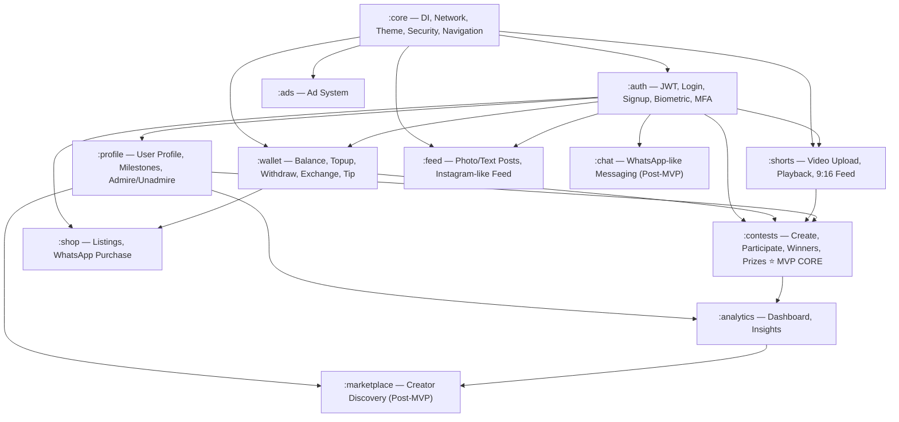
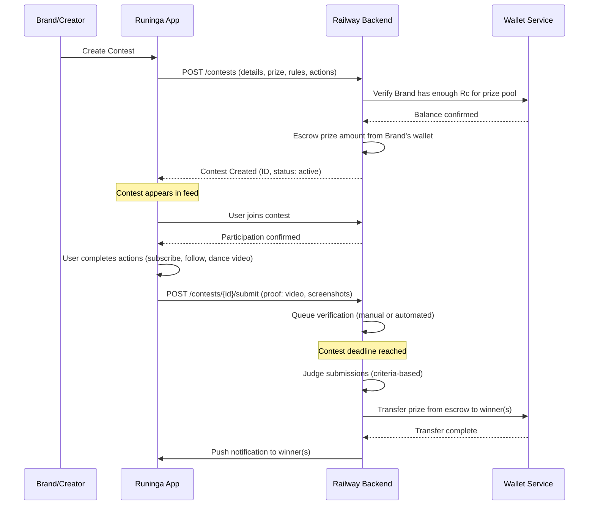

# Runinga — Full Implementation Plan

> **Creator-centric marketing engine** — KMP + Compose Multiplatform (Android-first, iOS-second)
> Railway Backend (Node.js) · Custom JWT · Server-side Payments · Cloudinary Media

---

## User Review Required

> [!IMPORTANT]
> **Contests are the core MVP feature.** The module order is dependency-driven — we must build Core → Auth → Wallet before Contests can function (contests need users, authentication, and Rc transactions). However, Contests will receive the most design attention and will be the first "feature" module fully wired end-to-end.

> [!WARNING]
> **Chat and Creator Marketplace are planned but deferred to post-MVP.** They are included in the architecture to ensure we don't paint ourselves into a corner, but they won't be implemented in the initial build phase.

> [!IMPORTANT]
> **Video size recommendation:** Industry standard for 3-min 9:16 shorts at 1080×1920:
> - **Codec**: H.264 (AAC audio)
> - **Bitrate**: 4–6 Mbps video, 128 kbps audio
> - **Max file size**: ~150 MB (hard limit), target ~80–100 MB after client-side compression
> - **Cloudinary** handles transcoding/adaptive bitrate on upload — we send the original and Cloudinary serves optimized versions
> - **Client-side**: Compress before upload using platform-native (Android MediaCodec / iOS AVAssetExportSession) via expect/actual

---

## Architecture Overview

### Module Dependency Graph



### KMP Source Set Strategy

```
composeApp/src/
├── commonMain/kotlin/com/runinga/     ← 85% of code lives here
│   ├── core/
│   ├── feature/auth/
│   ├── feature/wallet/
│   ├── feature/profile/
│   ├── feature/shorts/
│   ├── feature/feed/
│   ├── feature/contests/
│   ├── feature/shop/
│   ├── feature/analytics/
│   └── feature/ads/
├── androidMain/kotlin/com/runinga/    ← Android-specific (ExoPlayer, Location, Biometric)
└── iosMain/kotlin/com/runinga/        ← iOS-specific (AVPlayer, CLLocation, LocalAuth)
```

Each feature module follows **Clean Architecture** internally:

```
feature/{module}/
├── data/
│   ├── remote/          ← Ktor API service, DTOs
│   ├── local/           ← SQLDelight DAOs, DataStore cache
│   └── repository/      ← Repository implementations
├── domain/
│   ├── model/           ← Domain models (pure Kotlin)
│   ├── repository/      ← Repository interfaces
│   └── usecase/         ← Business logic use cases
└── presentation/
    ├── screen/          ← Compose screens
    ├── component/       ← Reusable UI components
    └── viewmodel/       ← ViewModels (Lifecycle-aware)
```

### Backend Architecture (Railway — Node.js)

```
backend/
├── src/
│   ├── config/           ← DB, Redis, env, Cloudinary config
│   ├── middleware/        ← Auth JWT, rate limiting, HMAC validation, error handler
│   ├── modules/
│   │   ├── auth/         ← Register, Login, Token refresh, MFA
│   │   ├── user/         ← Profile, Milestones, Admire/Unadmire
│   │   ├── wallet/       ← Balance, Topup, Withdraw, Exchange rates, Tip
│   │   ├── shorts/       ← Video metadata, feed queries
│   │   ├── feed/         ← Photo/text posts, likes, comments
│   │   ├── contests/     ← Contest CRUD, participation, judging, prizes
│   │   ├── shop/         ← Product listings, seller management
│   │   ├── analytics/    ← Aggregation, insights
│   │   └── ads/          ← Ad serving, impressions, clicks
│   ├── services/
│   │   ├── payment/      ← PayPal, Paystack, M-Pesa, Payoneer (server-side only)
│   │   ├── exchange/     ← Fawaz Ahmed currency API integration
│   │   ├── cloudinary/   ← Upload signatures, webhook handler
│   │   └── notification/ ← Push notifications (FCM/APNs)
│   └── utils/            ← Helpers, validators, crypto
├── prisma/
│   └── schema.prisma     ← PostgreSQL schema
├── package.json
├── tsconfig.json
└── Dockerfile            ← Railway deployment
```

**Tech stack (Backend):**
- **Runtime**: Node.js 22 + TypeScript
- **Framework**: Express.js (lightweight, battle-tested)
- **ORM**: Prisma (PostgreSQL)
- **Cache**: Redis (via Railway add-on) — feeds, leaderboards, rate limiting
- **Auth**: bcrypt + JWT (access + refresh tokens)
- **Validation**: Zod
- **File uploads**: Cloudinary SDK (server-side signed uploads)
- **Payments**: Server-side SDKs (PayPal REST, Paystack, M-Pesa Daraja, Payoneer)
- **WebSockets**: Socket.io (milestone race notifications, real-time contest updates)
- **Queue**: BullMQ + Redis (background jobs: exchange rate refresh, payout processing)

---

## Phase-by-Phase Implementation

---

### Phase 1: Core Infrastructure

> Foundation layer — everything depends on this.

#### 1A. [MOBILE] Core Module

##### [MODIFY] [libs.versions.toml](file:///c:/Users/ADMIN/appu/gradle/libs.versions.toml)
- Add versions for: Ktor 3.x, Koin 3.6.x, Voyager 1.1.x, Coil 3.x, SQLDelight 2.x, kotlinx-serialization, kotlinx-datetime, DataStore, ExoPlayer 2.19.x, security-crypto
- Add version catalog entries for all libraries

##### [MODIFY] [build.gradle.kts (composeApp)](file:///c:/Users/ADMIN/appu/composeApp/build.gradle.kts)
- Add kotlinx-serialization plugin
- Add SQLDelight plugin
- Add all dependency declarations for commonMain, androidMain, iosMain
- Configure SQLDelight database
- Enable R8 for release builds
- Add signing config placeholder

##### [MODIFY] [settings.gradle.kts](file:///c:/Users/ADMIN/appu/settings.gradle.kts)
- Rename root project to `Runinga`

##### [NEW] `commonMain/com/runinga/core/di/AppModule.kt`
- Root Koin module aggregating all feature modules
- Platform-specific module injection via expect/actual

##### [NEW] `commonMain/com/runinga/core/network/KtorClient.kt`
- Ktor HttpClient factory with:
  - ContentNegotiation (JSON with snake_case ↔ camelCase)
  - Auth (Bearer token interceptor with auto-refresh)
  - Logging (debug only)
  - Default request (base URL config)
  - Timeout configuration
  - Certificate pinning (via expect/actual for platform engines)

##### [NEW] `commonMain/com/runinga/core/network/ApiConstants.kt`
- Base URL (Railway backend), API version prefix
- Endpoint paths as constants

##### [NEW] `commonMain/com/runinga/core/network/NetworkResult.kt`
- Sealed class: `Success<T>`, `Error(code, message)`, `Loading`
- Extension functions for safe API calls with error mapping

##### [NEW] `commonMain/com/runinga/core/navigation/AppNavigator.kt`
- Voyager Tab-based navigation (Home, Discover, Contests, Shop, Profile)
- Nested stack navigation within each tab
- Deep link support

##### [NEW] `commonMain/com/runinga/core/theme/RuningaTheme.kt`
- Material3 dark/light theme
- Custom color palette (premium feel, NO purple per GEMINI.md rules)
- Typography (Inter/Outfit via Google Fonts)
- Shape system, elevation, spacing tokens

##### [NEW] `commonMain/com/runinga/core/theme/Colors.kt`
- Curated color palette — dark-mode-first
- Primary: Deep teal/emerald green
- Accent: Warm gold/amber
- Surface: Rich dark grays
- Status colors (success, error, warning)

##### [NEW] `commonMain/com/runinga/core/security/TokenManager.kt`
- `expect class TokenManager` — stores access/refresh tokens
- Android: EncryptedSharedPreferences + Android Keystore
- iOS: Keychain Services

##### [NEW] `commonMain/com/runinga/core/security/DeviceSecurity.kt`
- `expect class DeviceSecurity`
- Android: Root detection (RootBeer), emulator detection, SafetyNet/Play Integrity
- iOS: Jailbreak detection, debug detection

##### [NEW] `commonMain/com/runinga/core/location/LocationProvider.kt`
- `expect class LocationProvider`
- `getCurrentCountry(): String` — ISO country code ("KE", "NG", "US")
- `getCurrentCurrency(): String` — currency code ("KES", "NGN", "USD")
- Android: `Locale.getDefault()` + GPS fallback via FusedLocationProvider
- iOS: `Locale.current` + CLLocationManager fallback

##### [NEW] `commonMain/com/runinga/core/location/CurrencyMapper.kt`
- Country code → Currency code mapping (ISO 4217)
- Cache in DataStore, refresh on app launch

##### [NEW] `commonMain/com/runinga/core/datastore/PreferencesManager.kt`
- `expect class PreferencesManager`
- Wrapper around DataStore for: detected currency, theme preference, user session cache
- Android: AndroidX DataStore
- iOS: NSUserDefaults DataStore

##### [NEW] `commonMain/com/runinga/core/database/RuningaDatabase.kt`
- SQLDelight database definition
- Tables for offline cache: users, wallet_cache, feed_cache, contest_cache

##### [NEW] `commonMain/com/runinga/core/util/KrCurrencyFormatter.kt`
- Format `Rc.500 (~KES 850)` display strings
- Handle decimal precision per currency

##### [NEW] `commonMain/com/runinga/core/util/DateTimeUtil.kt`
- kotlinx-datetime helpers for contest deadlines, timestamps

##### [NEW] `commonMain/com/runinga/core/ui/components/`
- `RuningaTopBar.kt` — App bar with consistent styling
- `RuningaBottomBar.kt` — Bottom navigation (5 tabs)
- `LoadingIndicator.kt` — Branded loading spinner
- `ErrorState.kt` — Error display with retry button
- `EmptyState.kt` — Empty content placeholder
- `KrAmountDisplay.kt` — Rc amount + fiat conversion display component
- `KrAmountInput.kt` — Amount input with live fiat↔Rc conversion

##### [MODIFY] `commonMain/com/runinga/com/App.kt`
- Replace template content with Koin initialization + Voyager navigator + RuningaTheme

##### [NEW] `androidMain/com/runinga/core/di/PlatformModule.android.kt`
- Android-specific Koin bindings (Context, ExoPlayer, Location)

##### [NEW] `iosMain/com/runinga/core/di/PlatformModule.ios.kt`
- iOS-specific Koin bindings

##### [MODIFY] `androidMain/com/runinga/com/MainActivity.kt`
- Initialize Koin in Application class
- Handle edge-to-edge display, safe areas

##### [NEW] `androidMain/com/runinga/com/RuningaApplication.kt`
- Application class with Koin startup

##### [MODIFY] `androidMain/AndroidManifest.xml`
- Add permissions: INTERNET, ACCESS_FINE_LOCATION, ACCESS_COARSE_LOCATION, CAMERA, READ_EXTERNAL_STORAGE
- Add `RuningaApplication` as application class
- Add `usesCleartextTraffic="false"`
- Add network security config

##### [NEW] `androidMain/res/xml/network_security_config.xml`
- Certificate pinning rules
- Disable cleartext traffic

#### 1B. [BACKEND] Core Infrastructure

##### [NEW] `backend/package.json`
- Dependencies: express, prisma, @prisma/client, jsonwebtoken, bcrypt, zod, socket.io, bullmq, ioredis, cors, helmet, express-rate-limit, cloudinary, axios

##### [NEW] `backend/tsconfig.json`
- Strict TypeScript config

##### [NEW] `backend/src/index.ts`
- Express server setup with middleware chain
- Socket.io initialization
- Graceful shutdown

##### [NEW] `backend/src/config/database.ts`
- Prisma client singleton

##### [NEW] `backend/src/config/redis.ts`
- Redis connection (Railway add-on URL)

##### [NEW] `backend/src/config/env.ts`
- Environment variable validation with Zod

##### [NEW] `backend/src/middleware/auth.ts`
- JWT verification middleware
- Token refresh logic
- HMAC request signature validation

##### [NEW] `backend/src/middleware/rateLimiter.ts`
- Redis-based rate limiting per endpoint category

##### [NEW] `backend/src/middleware/errorHandler.ts`
- Global error handler with structured error responses

##### [NEW] `backend/Dockerfile`
- Multi-stage Docker build for Railway deployment

##### [NEW] `backend/prisma/schema.prisma`
- Full PostgreSQL schema (see Schema section below)

##### [NEW] `backend/.env.example`
- Template for all required environment variables

---

### Phase 2: Auth Module

> Custom JWT authentication with biometric unlock and MFA.

#### 2A. [MOBILE] Auth Feature

##### [NEW] `commonMain/com/runinga/feature/auth/data/remote/AuthApi.kt`
- Ktor endpoints: `/auth/register`, `/auth/login`, `/auth/refresh`, `/auth/verify-otp`, `/auth/logout`

##### [NEW] `commonMain/com/runinga/feature/auth/data/remote/dto/`
- `LoginRequestDto.kt`, `RegisterRequestDto.kt`, `AuthResponseDto.kt`, `RefreshTokenDto.kt`
- All DTOs use kotlinx.serialization with `@SerialName` for snake_case mapping

##### [NEW] `commonMain/com/runinga/feature/auth/data/repository/AuthRepositoryImpl.kt`
- Implements AuthRepository interface
- Handles token storage via TokenManager
- Manages auth state flow

##### [NEW] `commonMain/com/runinga/feature/auth/domain/model/User.kt`
- Domain model: id, username, displayName, email, phone, avatarUrl, bio, country, currency, isVerified, createdAt

##### [NEW] `commonMain/com/runinga/feature/auth/domain/repository/AuthRepository.kt`
- Interface: login, register, refreshToken, logout, getCurrentUser, isAuthenticated

##### [NEW] `commonMain/com/runinga/feature/auth/domain/usecase/`
- `LoginUseCase.kt`, `RegisterUseCase.kt`, `RefreshTokenUseCase.kt`, `ValidateInputUseCase.kt`

##### [NEW] `commonMain/com/runinga/feature/auth/presentation/viewmodel/AuthViewModel.kt`
- Login/Register state management
- Form validation
- Auth state observation

##### [NEW] `commonMain/com/runinga/feature/auth/presentation/screen/LoginScreen.kt`
- Email/phone + password login
- Biometric unlock option
- "Sign up" navigation
- Premium design with gradient background, glassmorphism cards

##### [NEW] `commonMain/com/runinga/feature/auth/presentation/screen/RegisterScreen.kt`
- Step-by-step registration: Email → Password → Username → Phone (optional)
- OTP verification step
- Terms acceptance

##### [NEW] `commonMain/com/runinga/feature/auth/presentation/screen/BiometricSetupScreen.kt`
- Biometric enrollment prompt after first login

##### [NEW] `commonMain/com/runinga/feature/auth/di/AuthModule.kt`
- Koin module for auth dependencies

##### [NEW] `androidMain/com/runinga/feature/auth/BiometricAuthManager.android.kt`
- AndroidX Biometric API implementation

##### [NEW] `iosMain/com/runinga/feature/auth/BiometricAuthManager.ios.kt`
- iOS LocalAuthentication framework

#### 2B. [BACKEND] Auth Module

##### [NEW] `backend/src/modules/auth/auth.routes.ts`
- POST `/auth/register` — Create account
- POST `/auth/login` — Login (returns access + refresh tokens)
- POST `/auth/refresh` — Refresh access token
- POST `/auth/verify-otp` — Verify phone/email OTP
- POST `/auth/logout` — Invalidate refresh token
- POST `/auth/biometric` — Register biometric credential

##### [NEW] `backend/src/modules/auth/auth.controller.ts`
- Request validation, response formatting

##### [NEW] `backend/src/modules/auth/auth.service.ts`
- bcrypt password hashing (12 rounds)
- JWT generation (15min access, 7d refresh)
- OTP generation and verification
- Refresh token rotation (single-use refresh tokens)
- Device binding

##### [NEW] `backend/src/modules/auth/auth.validation.ts`
- Zod schemas for all auth endpoints

---

### Phase 3: Wallet Module

> Rc platform currency with multi-provider payment integration (all server-side).

#### 3A. [MOBILE] Wallet Feature

##### [NEW] `commonMain/com/runinga/feature/wallet/data/remote/WalletApi.kt`
- GET `/wallet/balance` — Current Rc balance
- POST `/wallet/topup/initiate` — Start topup flow (returns provider redirect/reference)
- POST `/wallet/withdraw/initiate` — Start withdrawal
- GET `/wallet/transactions` — Transaction history
- POST `/wallet/tip` — Send tip to creator
- GET `/wallet/exchange-rate?from={currency}&to=kr` — Current rate

##### [NEW] `commonMain/com/runinga/feature/wallet/data/remote/dto/`
- `WalletBalanceDto.kt`, `TopupRequestDto.kt`, `WithdrawRequestDto.kt`, `TransactionDto.kt`, `ExchangeRateDto.kt`, `TipRequestDto.kt`

##### [NEW] `commonMain/com/runinga/feature/wallet/data/local/WalletCacheDao.kt`
- SQLDelight: cached balance, cached transactions (offline display)

##### [NEW] `commonMain/com/runinga/feature/wallet/data/repository/WalletRepositoryImpl.kt`
- Fetches from API, caches locally
- **Balance is ALWAYS server-authoritative** — local is display-only cache
- Refresh on: app launch, wallet access, pull-to-refresh

##### [NEW] `commonMain/com/runinga/feature/wallet/domain/model/`
- `WalletBalance.kt` — krBalance, fiatEquivalent, currency, lastUpdated
- `Transaction.kt` — id, type (topup/withdraw/tip/contest_prize/purchase), amount, currency, status, timestamp
- `ExchangeRate.kt` — fromCurrency, toCurrency, rate, marginRate (4.5% platform margin), fetchedAt

##### [NEW] `commonMain/com/runinga/feature/wallet/domain/repository/WalletRepository.kt`

##### [NEW] `commonMain/com/runinga/feature/wallet/domain/usecase/`
- `GetBalanceUseCase.kt` — Fetch balance, format with fiat equivalent
- `InitiateTopupUseCase.kt` — Determine available providers by country, initiate
- `InitiateWithdrawUseCase.kt` — Validate minimum withdrawal, initiate
- `GetTransactionsUseCase.kt` — Paginated transaction history
- `SendTipUseCase.kt` — Tip validation and sending
- `GetExchangeRateUseCase.kt` — Live rate with 4.5% margin applied

##### [NEW] `commonMain/com/runinga/feature/wallet/presentation/viewmodel/WalletViewModel.kt`
- Balance state (with fiat conversion)
- Transaction list state
- Topup/Withdraw flow state
- Exchange rate polling

##### [NEW] `commonMain/com/runinga/feature/wallet/presentation/screen/WalletScreen.kt`
- Balance card showing `Rc.{amount}` with fiat below
- Quick actions: Topup, Withdraw, Tip, History
- Recent transactions list
- Screenshot prevention on this screen (secure flag)

##### [NEW] `commonMain/com/runinga/feature/wallet/presentation/screen/TopupScreen.kt`
- Amount input in local fiat currency
- Live conversion display as user types: "You'll receive Rc.{amount}"
- Payment method selection (based on detected country):
  - 🌍 International: PayPal (card only)
  - 🇰🇪 Kenya: M-Pesa, PayPal
  - 🇳🇬 Nigeria: Paystack, PayPal
  - 🇬🇭 Ghana: Paystack, PayPal
  - Other Paystack-supported: Paystack, PayPal
- Confirmation screen with exchange rate, fee breakdown, PIN/biometric verification

##### [NEW] `commonMain/com/runinga/feature/wallet/presentation/screen/WithdrawScreen.kt`
- Enter Rc amount → shows fiat equivalent
- Withdrawal method (based on country):
  - 🇰🇪 Kenya: M-Pesa
  - 🌍 International: Payoneer
- Minimum withdrawal: Rc.10 (~equivalent)
- Processing time notice
- PIN/biometric verification required

##### [NEW] `commonMain/com/runinga/feature/wallet/presentation/screen/TransactionHistoryScreen.kt`
- Filterable by type (all, topups, withdrawals, tips, prizes, purchases)
- Paginated with pull-to-refresh

##### [NEW] `commonMain/com/runinga/feature/wallet/presentation/screen/TipScreen.kt`
- Select/search creator to tip
- Enter amount (fiat → Rc conversion live)
- Optional message
- Confirm with PIN/biometric

##### [NEW] `commonMain/com/runinga/feature/wallet/presentation/component/`
- `BalanceCard.kt` — Animated balance display with glassmorphism
- `PaymentMethodCard.kt` — Payment provider selector
- `TransactionItem.kt` — Single transaction row
- `ExchangeRateBar.kt` — Current rate banner

##### [NEW] `commonMain/com/runinga/feature/wallet/di/WalletModule.kt`

#### 3B. [BACKEND] Wallet Module

##### [NEW] `backend/src/modules/wallet/wallet.routes.ts`
##### [NEW] `backend/src/modules/wallet/wallet.controller.ts`
##### [NEW] `backend/src/modules/wallet/wallet.service.ts`
- **Balance management**: Atomic PostgreSQL transactions for all balance changes
- **Topup flow**: 
  1. App → POST `/wallet/topup/initiate` (amount, currency, provider)
  2. Server validates, creates pending transaction, returns provider-specific data
  3. Provider webhook → Server verifies signature → Credits Rc balance
- **Withdrawal flow**:
  1. App → POST `/wallet/withdraw/initiate` (krAmount, provider, destination)
  2. Server validates balance, creates pending transaction, queues payout
  3. BullMQ worker processes payout via provider API
  4. On success → Debit Rc balance

##### [NEW] `backend/src/services/payment/paypal.service.ts`
- PayPal REST API v2 (Orders API)
- Card payments only (no PayPal wallet)
- Webhook verification

##### [NEW] `backend/src/services/payment/paystack.service.ts`
- Paystack API integration
- Initialize transaction → Return authorization_url
- Webhook verification (IP whitelist + signature)

##### [NEW] `backend/src/services/payment/mpesa.service.ts`
- Safaricom Daraja API v2
- STK Push (topup) — C2B
- B2C (withdrawal)
- Callback URL handling + verification

##### [NEW] `backend/src/services/payment/payoneer.service.ts`
- Payoneer Mass Payouts API
- Payee registration
- Payout submission + status tracking

##### [NEW] `backend/src/services/exchange/exchange.service.ts`
- Fetch rates from: `https://cdn.jsdelivr.net/npm/@fawazahmed0/currency-api@latest/v1/currencies/{base}.json`
- Cache rates in Redis (TTL: 5 minutes)
- Apply 4.5% platform margin (buy rate + 4.5%, sell rate - 4.5%)
- Fallback to cached rate if API is down
- BullMQ scheduled job: refresh popular rates every 5 minutes

---

### Phase 4: Profile + Milestones Module

#### 4A. [MOBILE] Profile Feature

##### [NEW] `commonMain/com/runinga/feature/profile/data/remote/ProfileApi.kt`
- GET `/users/{id}` — User profile
- PUT `/users/me` — Update profile
- POST `/users/{id}/admire` — Follow (Admire)
- DELETE `/users/{id}/admire` — Unfollow (Unadmire)
- GET `/users/{id}/admirers` — Followers list
- GET `/users/{id}/admiring` — Following list
- GET `/users/me/milestones` — User's milestone progress
- GET `/milestones` — Available milestones

##### [NEW] `commonMain/com/runinga/feature/profile/domain/model/`
- `UserProfile.kt` — Full profile with stats (admirers, admiring, contests won, Rc earned)
- `Milestone.kt` — id, title, description, requirement, reward (Rc), isCompleted, completedBy (first person), progress
- `BioLink.kt` — label, url, icon

##### [NEW] `commonMain/com/runinga/feature/profile/presentation/screen/ProfileScreen.kt`
- Cover photo + avatar
- Display name, username, bio, bio links
- Stats row: Admirers | Admiring | Contests Won | Rc Earned
- Admire/Unadmire button (animated)
- Tabs: Posts | Shorts | Contests | Shop

##### [NEW] `commonMain/com/runinga/feature/profile/presentation/screen/EditProfileScreen.kt`
##### [NEW] `commonMain/com/runinga/feature/profile/presentation/screen/MilestonesScreen.kt`
- List of milestones with progress bars
- Completed milestones with checkmark and who completed it first
- Available milestones with progress indicators
- Reward display in Rc

##### [NEW] `commonMain/com/runinga/feature/profile/presentation/screen/AdmirersListScreen.kt`
##### [NEW] `commonMain/com/runinga/feature/profile/presentation/screen/AdmiringListScreen.kt`

#### 4B. [BACKEND] Profile Module

##### [NEW] `backend/src/modules/user/user.routes.ts`
##### [NEW] `backend/src/modules/user/user.service.ts`
- Profile CRUD
- Admire/Unadmire with Redis counters for fast read
- Milestone checking: background job checks milestone conditions, **only first completer gets rewarded**
- Bio link management

---

### Phase 5: Shorts Module (Video)

#### 5A. [MOBILE] Shorts Feature

##### [NEW] `commonMain/com/runinga/feature/shorts/data/remote/ShortsApi.kt`
- GET `/shorts/feed?tab={home|discover|admiring}&cursor={cursor}` — Paginated feed
- POST `/shorts` — Create short (metadata after Cloudinary upload)
- POST `/shorts/{id}/like`, DELETE `/shorts/{id}/like`
- POST `/shorts/{id}/comment`
- GET `/shorts/{id}/comments`
- POST `/shorts/upload-signature` — Get Cloudinary upload signature

##### [NEW] `commonMain/com/runinga/feature/shorts/domain/model/`
- `Short.kt` — id, creator, videoUrl, thumbnailUrl, caption, likes, comments, views, createdAt, isFromContest
- `Comment.kt` — id, user, text, createdAt

##### [NEW] `commonMain/com/runinga/feature/shorts/presentation/screen/ShortsScreen.kt`
- **Full-screen 9:16 vertical pager** (swipe up/down)
- Three sub-tabs at top: Home (contest submissions) | Discover (For You) | Admiring (Following)
- Overlay: creator name, caption, like/comment/share buttons
- Auto-play current, preload next

##### [NEW] `commonMain/com/runinga/feature/shorts/presentation/screen/CreateShortScreen.kt`
- Video picker from gallery
- Record via camera (expect/actual)
- Client-side compression before upload (expect/actual)
- Caption input, contest tagging (optional)
- Upload progress with animated indicator

##### [NEW] `commonMain/com/runinga/feature/shorts/presentation/component/`
- `VideoPlayer.kt` — expect/actual (ExoPlayer Android / AVPlayer iOS)
- `VideoControls.kt` — Play/pause, progress, mute
- `ShortOverlay.kt` — Creator info, action buttons
- `CommentSheet.kt` — Bottom sheet with comments

##### [NEW] `androidMain/com/runinga/feature/shorts/VideoPlayerImpl.android.kt`
- ExoPlayer 2.19+ with cache
- OkHttp DataSource for Ktor compatibility

##### [NEW] `iosMain/com/runinga/feature/shorts/VideoPlayerImpl.ios.kt`
- AVPlayer with AVPlayerLayer

##### [NEW] `commonMain/com/runinga/feature/shorts/presentation/screen/UploadVideoScreen.kt`
- Direct upload to Cloudinary via Ktor (signed upload)
- Progress tracking
- Retry on failure

#### 5B. [BACKEND] Shorts Module

##### [NEW] `backend/src/modules/shorts/shorts.routes.ts`
##### [NEW] `backend/src/modules/shorts/shorts.service.ts`
- Feed algorithm (Discover: engagement-weighted, Admiring: chronological from followed users)
- Cloudinary webhook: process video metadata (duration validation ≤ 3 min, resolution check)
- Comment moderation hooks
- View counting (debounced, Redis → PostgreSQL batch write)

##### [NEW] `backend/src/services/cloudinary/cloudinary.service.ts`
- Signed upload URL generation
- Upload presets (9:16, max 3min, H.264)
- Webhook handler for transformation completion
- Adaptive streaming (HLS) auto-generation

---

### Phase 6: Feed Module (Instagram-like Posts)

#### 6A. [MOBILE] Feed Feature

##### [NEW] `commonMain/com/runinga/feature/feed/data/remote/FeedApi.kt`
- GET `/feed?cursor={cursor}` — Paginated feed
- POST `/feed` — Create post (photo + text)
- POST `/feed/{id}/like`, DELETE `/feed/{id}/like`
- POST `/feed/{id}/comment`

##### [NEW] `commonMain/com/runinga/feature/feed/domain/model/`
- `Post.kt` — id, creator, imageUrls (up to 10), caption, likes, comments, createdAt
- `FeedComment.kt`

##### [NEW] `commonMain/com/runinga/feature/feed/presentation/screen/FeedScreen.kt`
- Scrollable feed of photo + text posts
- Like animation (double-tap heart)
- Comments bottom sheet
- Lazy loading with pagination

##### [NEW] `commonMain/com/runinga/feature/feed/presentation/screen/CreatePostScreen.kt`
- Photo picker (multi-select up to 10)
- Caption editor
- Upload to Cloudinary → Create post

##### [NEW] `commonMain/com/runinga/feature/feed/presentation/component/`
- `PostCard.kt` — Avatar, name, photo carousel, caption, like/comment row
- `PhotoCarousel.kt` — Swipeable photo pager with dots
- `LikeAnimation.kt` — Heart burst animation on double-tap

#### 6B. [BACKEND] Feed Module

##### [NEW] `backend/src/modules/feed/feed.routes.ts`
##### [NEW] `backend/src/modules/feed/feed.service.ts`

---

### Phase 7: Contests Module ⭐ (MVP CORE)

> **This is the heart of Runinga.** Result-based marketing engine where businesses/creators run contests that reward actual outcomes (subscribes, follows, actions) not vanity metrics.

#### Contest Flow



#### 7A. [MOBILE] Contests Feature

##### [NEW] `commonMain/com/runinga/feature/contests/data/remote/ContestApi.kt`
- POST `/contests` — Create contest
- GET `/contests?status={active|completed|upcoming}&cursor={cursor}` — List contests
- GET `/contests/{id}` — Contest details
- POST `/contests/{id}/join` — Join contest
- POST `/contests/{id}/submit` — Submit entry (video, proof)
- GET `/contests/{id}/submissions` — View submissions
- GET `/contests/{id}/leaderboard` — Contest leaderboard
- POST `/contests/{id}/vote/{submissionId}` — Vote on submission (if contest type allows)
- GET `/contests/my-contests` — Created contests
- GET `/contests/my-entries` — Participated contests

##### [NEW] `commonMain/com/runinga/feature/contests/domain/model/`
- `Contest.kt`:
  ```kotlin
  data class Contest(
      val id: String,
      val creator: UserProfile,
      val title: String,
      val description: String,
      val type: ContestType, // DANCE, CHALLENGE, PROMOTION, CREATIVE
      val prize: ContestPrize,
      val rules: List<ContestRule>,
      val requiredActions: List<ContestAction>, // SUBSCRIBE_YOUTUBE, FOLLOW_SPOTIFY, FOLLOW_INSTAGRAM, etc.
      val maxWinners: Int, // 1-3
      val judgingCriteria: JudgingCriteria, // CREATOR_PICKS, COMMUNITY_VOTE, MOST_ENGAGEMENT
      val deadline: Instant,
      val status: ContestStatus, // DRAFT, ACTIVE, JUDGING, COMPLETED, CANCELLED
      val totalParticipants: Int,
      val totalSubmissions: Int,
      val mediaUrl: String?, // Contest cover/promo video
      val createdAt: Instant
  )
  ```
- `ContestPrize.kt`:
  ```kotlin
  data class ContestPrize(
      val totalKr: Double, // Total prize pool in Rc
      val distribution: List<PrizeDistribution>, // e.g., [1st: 60%, 2nd: 25%, 3rd: 15%]
      val fiatEquivalent: String // Display: "~KES 8,500"
  )
  ```
- `ContestAction.kt`:
  ```kotlin
  data class ContestAction(
      val type: ActionType, // SUBSCRIBE_YOUTUBE, FOLLOW_SPOTIFY, FOLLOW_INSTAGRAM, FOLLOW_TIKTOK, CUSTOM
      val targetUrl: String, // Channel/profile URL
      val label: String, // "Subscribe to my YouTube"
      val isVerifiable: Boolean // Can be auto-verified via API
  )
  ```
- `ContestSubmission.kt` — id, participant, videoUrl, proofScreenshots, actionCompletionStatus, votes, rank, submittedAt
- `ContestWinner.kt` — participant, rank, prizeAmount

##### [NEW] `commonMain/com/runinga/feature/contests/domain/usecase/`
- `CreateContestUseCase.kt` — Validate contest, verify creator balance for escrow
- `JoinContestUseCase.kt` — Check eligibility, enrollment
- `SubmitEntryUseCase.kt` — Upload proof + video
- `GetContestFeedUseCase.kt` — Filtered contest feeds
- `GetLeaderboardUseCase.kt`

##### [NEW] `commonMain/com/runinga/feature/contests/presentation/viewmodel/`
- `ContestFeedViewModel.kt` — Feed state, filtering, pagination
- `ContestDetailViewModel.kt` — Single contest state, join/submit actions
- `CreateContestViewModel.kt` — Multi-step contest creation form state
- `ContestSubmissionViewModel.kt`

##### [NEW] `commonMain/com/runinga/feature/contests/presentation/screen/ContestFeedScreen.kt`
- Full-screen 9:16 feed of contest submission videos
- Contest info overlay (prize, deadline, actions required)
- "Join Contest" CTA
- Filter tabs: Active | Trending | Ending Soon | My Entries

##### [NEW] `commonMain/com/runinga/feature/contests/presentation/screen/ContestDetailScreen.kt`
- Contest cover media (video/image)
- Title, description, creator info
- **Prize pool display**: `Rc.500 (~KES 850)` with winner distribution breakdown
- **Required Actions list** with completion checkmarks:
  - ☐ Subscribe to YouTube Channel → [Open Link]
  - ☐ Follow on Spotify → [Open Link]
  - ☐ Post a dance video with #tag
- Countdown timer to deadline
- "Join Contest" / "Submit Entry" CTA
- Leaderboard preview
- Submissions gallery

##### [NEW] `commonMain/com/runinga/feature/contests/presentation/screen/CreateContestScreen.kt`
- **Multi-step wizard**:
  1. **Basics**: Title, description, type, cover media
  2. **Actions**: Add required actions (YouTube subscribe, Spotify follow, etc.) with target URLs
  3. **Prize**: Set prize pool (enter in fiat → shows Rc equivalent), number of winners (1-3), distribution split
  4. **Rules**: Deadline, judging criteria, additional rules
  5. **Review & Pay**: Summary, escrow confirmation from wallet, publish

##### [NEW] `commonMain/com/runinga/feature/contests/presentation/screen/SubmitEntryScreen.kt`
- Action completion checklist (mark each done, optional proof screenshots)
- Video upload (9:16 short)
- Submit button

##### [NEW] `commonMain/com/runinga/feature/contests/presentation/screen/ContestLeaderboardScreen.kt`
- Ranked submissions
- Vote button (if community voting)
- Prize distribution preview

##### [NEW] `commonMain/com/runinga/feature/contests/presentation/screen/ContestWinnersScreen.kt`
- Podium-style winner display with animated reveal
- Prize amounts credited

##### [NEW] `commonMain/com/runinga/feature/contests/presentation/component/`
- `ContestCard.kt` — Compact contest card for lists
- `ContestOverlay.kt` — Full-screen overlay on submission videos
- `PrizePoolBadge.kt` — Animated Rc prize display
- `ActionChecklistItem.kt` — Individual required action with status
- `CountdownTimer.kt` — Live countdown to deadline
- `WinnerPodium.kt` — Animated podium component
- `JudgingCriteriaBadge.kt`

##### [NEW] `commonMain/com/runinga/feature/contests/di/ContestModule.kt`

#### 7B. [BACKEND] Contests Module

##### [NEW] `backend/src/modules/contests/contest.routes.ts`
##### [NEW] `backend/src/modules/contests/contest.controller.ts`
##### [NEW] `backend/src/modules/contests/contest.service.ts`
- **Create contest**: Validate → Escrow Rc from creator's wallet (atomic transaction) → Create contest record
- **Join contest**: Eligibility check (not creator, not already joined)
- **Submit entry**: Store submission with proof, queue action verification
- **Judging**: When deadline hits, BullMQ job triggers:
  - CREATOR_PICKS: Notify creator to select winners
  - COMMUNITY_VOTE: Tally votes, rank
  - MOST_ENGAGEMENT: Rank by video engagement metrics
- **Prize distribution**: Atomic transfer from escrow to winners' wallets
- **Cancellation**: Return escrowed funds to creator

##### [NEW] `backend/src/modules/contests/contest.verification.ts`
- Action verification service (planned: YouTube API subscription check, Spotify follow check)
- Manual proof review queue for non-verifiable actions
- Anti-fraud checks

---

### Phase 8: Shop Module

#### 8A. [MOBILE] Shop Feature

##### [NEW] `commonMain/com/runinga/feature/shop/data/remote/ShopApi.kt`
- GET `/shop/products?category={cat}&cursor={cursor}`
- GET `/shop/products/{id}`
- POST `/shop/products` — List a product (seller)
- PUT `/shop/products/{id}`
- DELETE `/shop/products/{id}`

##### [NEW] `commonMain/com/runinga/feature/shop/domain/model/`
- `Product.kt` — id, seller, title, description, imageUrls, priceKr, priceFiat, category, whatsappNumber, createdAt

##### [NEW] `commonMain/com/runinga/feature/shop/presentation/screen/ShopScreen.kt`
- Grid/List of products with search and category filters
- Product cards with image, price (Rc + fiat), seller

##### [NEW] `commonMain/com/runinga/feature/shop/presentation/screen/ProductDetailScreen.kt`
- Product images carousel
- Price: `Rc.50 (~KES 85)`
- Seller info
- "Buy via WhatsApp" button → Opens WhatsApp with pre-filled message:
  ```
  Hello, I am interested in this product
  [Product Image URL]
  [Product Name] - Rc.50 (~KES 85)
  ```

##### [NEW] `commonMain/com/runinga/feature/shop/presentation/screen/CreateListingScreen.kt`
- Product creation form for sellers

#### 8B. [BACKEND] Shop Module

##### [NEW] `backend/src/modules/shop/shop.routes.ts`
##### [NEW] `backend/src/modules/shop/shop.service.ts`

---

### Phase 9: Analytics + Ads Module

#### 9A. [MOBILE] Analytics Feature

##### [NEW] `commonMain/com/runinga/feature/analytics/presentation/screen/AnalyticsScreen.kt`
- Engagement metrics: views, likes, admirers growth
- Contest performance: participation rate, completion rate
- Earnings breakdown: tips, contest prizes, ad revenue
- Charts and visualizations

#### 9B. [MOBILE] Ads Feature

##### [NEW] `commonMain/com/runinga/feature/ads/presentation/component/`
- `NativeAdBanner.kt` — In-feed native ad
- `InterstitialAd.kt` — Between content transitions
- `RewardedAd.kt` — Watch ad for Rc reward

#### 9C. [BACKEND] Analytics + Ads Modules

##### [NEW] `backend/src/modules/analytics/analytics.service.ts`
##### [NEW] `backend/src/modules/ads/ads.service.ts`

---

### Phase 10: Android Release Build

##### [MODIFY] `composeApp/build.gradle.kts`
- Enable R8 for release: `isMinifyEnabled = true`
- Add ProGuard rules file
- Signing config (keystore)

##### [NEW] `composeApp/proguard-rules.pro`
- Keep rules for: Ktor, kotlinx-serialization, Koin, Voyager
- Aggressive obfuscation for security classes
- Remove logging in release
- Keep rules for payment-related DTOs

##### [NEW] Signing configuration
- Keystore setup instructions
- Build variant configuration

---

### Post-MVP Modules (Architecture Reserved)

#### Chat Module (WhatsApp-like)
- Socket.io real-time messaging
- End-to-end encryption (Signal Protocol via libsignal)
- Media sharing (photos, videos, voice notes)
- Group chats
- Message status (sent, delivered, read)

#### Creator Marketplace
- Brand/Creator discovery with filters (niche, reach, engagement rate, location)
- Collaboration requests
- Rate cards
- Portfolio showcase
- Campaign management

---

## Database Schema (Core Tables)

```sql
-- Users
users (id, email, phone, username, display_name, avatar_url, bio, country, currency, is_verified, created_at)

-- Auth
refresh_tokens (id, user_id, token_hash, device_id, expires_at, created_at)

-- Wallet
wallets (id, user_id, kr_balance, created_at, updated_at)
transactions (id, user_id, type, amount_kr, amount_fiat, currency, provider, status, reference, created_at)
escrows (id, contest_id, user_id, amount_kr, status, created_at)

-- Social
admires (id, admirer_id, admired_id, created_at)
bio_links (id, user_id, label, url, icon, order)

-- Milestones
milestones (id, title, description, requirement_type, requirement_value, reward_kr, created_at)
milestone_completions (id, milestone_id, user_id, completed_at) -- first user only

-- Shorts
shorts (id, user_id, video_url, thumbnail_url, caption, contest_id, views, likes_count, comments_count, created_at)
short_likes (id, short_id, user_id, created_at)
short_comments (id, short_id, user_id, text, created_at)

-- Feed Posts
posts (id, user_id, caption, image_urls, likes_count, comments_count, created_at)
post_likes (id, post_id, user_id, created_at)
post_comments (id, post_id, user_id, text, created_at)

-- Contests (CORE)
contests (id, creator_id, title, description, type, cover_media_url, prize_total_kr, max_winners,
          judging_criteria, deadline, status, total_participants, total_submissions, created_at)
contest_actions (id, contest_id, action_type, target_url, label, is_verifiable, order)
contest_prize_distribution (id, contest_id, rank, percentage)
contest_participants (id, contest_id, user_id, joined_at)
contest_submissions (id, contest_id, user_id, video_url, proof_urls, votes_count, rank, submitted_at)
contest_action_completions (id, submission_id, action_id, is_completed, proof_url)
contest_winners (id, contest_id, user_id, rank, prize_kr, awarded_at)

-- Shop
products (id, seller_id, title, description, image_urls, price_kr, category, whatsapp_number, status, created_at)

-- Analytics
daily_stats (id, user_id, date, views, likes, new_admirers, kr_earned)
```

---

## Offline Strategy

| Data | Offline Behavior | Sync Strategy |
|------|-------------------|---------------|
| **Wallet balance** | Show cached (with "last updated" timestamp) | Refresh on access, pull-to-refresh |
| **Feed/Shorts** | Show cached posts/videos | Cursor-based pagination, cache latest page |
| **Contest list** | Show cached active contests | Refresh on tab switch |
| **Profile** | Show cached profile | Refresh on profile access |
| **Transactions** | Show cached history | Refresh on wallet access |
| **Actions (like, tip, submit)** | Queue locally, sync when online | Background sync with conflict resolution |

> [!IMPORTANT]
> **Wallet balance is NEVER modified locally.** The app only displays a cached version. All balance changes go through the backend. If offline, actions that would modify balance are queued and synced when connectivity returns, with server-side validation.

---

## Verification Plan

### Automated Tests
- **Backend**: Jest unit tests for each service, Supertest for API integration tests
- **Mobile**: kotlin.test for domain/use case unit tests, Compose UI tests for critical screens
- **Build**: `.\gradlew.bat :composeApp:assembleDebug` must pass
- **Backend**: `npm run test` must pass with ≥80% coverage on core modules (wallet, contests, auth)

### Manual Verification
- Android emulator testing for each module completion
- Payment flow testing with provider sandboxes (PayPal sandbox, Paystack test keys, M-Pesa sandbox)
- Contest end-to-end flow: Create → Join → Submit → Judge → Prize distribution

### Security Verification
- OWASP Mobile Top 10 checklist
- JWT token lifecycle testing (expiry, refresh, rotation)
- Payment idempotency testing
- Root detection verification

---

## Implementation Order Summary

| # | Module | Estimated Scope | Depends On |
|---|--------|-----------------|------------|
| 1 | **Core Infrastructure** | ~40 files | — |
| 2 | **Auth** | ~25 files | Core |
| 3 | **Wallet** | ~35 files | Core, Auth |
| 4 | **Profile + Milestones** | ~25 files | Core, Auth |
| 5 | **Shorts (Video)** | ~30 files | Core, Auth |
| 6 | **Feed (Posts)** | ~20 files | Core, Auth |
| 7 | **Contests ⭐** | ~40 files | Core, Auth, Wallet, Shorts, Profile |
| 8 | **Shop** | ~20 files | Core, Auth, Wallet |
| 9 | **Analytics + Ads** | ~15 files | All above |
| 10 | **Release Build** | ~5 files | All above |
| — | Chat (Post-MVP) | ~30 files | Core, Auth |
| — | Marketplace (Post-MVP) | ~25 files | Core, Auth, Profile, Analytics |

> Each module = Mobile (commonMain + androidMain + iosMain) + Backend (routes + controller + service)
