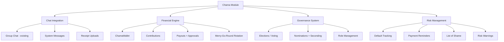

# Phase 3: Chama Integration — Implementation Plan

> **Status**: PLANNING → Awaiting user confirmation  
> **Complexity**: 🔴 Very High (15+ new DB models, 3 backend services, 8+ mobile screens)  
> **Estimated Sub-phases**: 5

---

## 1. Architecture Overview



---

## 2. Database Schema Design (15 New Models + 6 Enums)

### Enums

| Enum | Values | Purpose |
|------|--------|---------|
| `ChamaType` | `ROTATING`, `INVESTMENT`, `WELFARE`, `HYBRID` | Type of savings group |
| `ChamaStatus` | `SETUP`, `ACTIVE`, `PAUSED`, `COMPLETED`, `DISSOLVED` | Lifecycle state |
| `ChamaRole` | `ADMIN`, `CHAIRPERSON`, `TREASURER`, `SECRETARY`, `MEMBER` | Member roles |
| `ContributionFrequency` | `DAILY`, `WEEKLY`, `BIWEEKLY`, `MONTHLY`, `ONE_OFF` | How often members pay |
| `ChamaMemberStatus` | `ACTIVE`, `SUSPENDED`, `LEFT`, `REMOVED`, `DEFAULTED` | Member state |
| `ElectionPhase` | `NOMINATION`, `SECONDING`, `VOTING`, `COMPLETED` | Voting lifecycle |

### Core Models

#### `Chama` — The savings group entity
```
- id, name, type, description, reason, avatarUrl
- chatId → links to existing Chat (GROUP type)
- maxMembers, isLocked, autoLockOnFull
- contributionAmountKr, contributionFrequency
- membershipFeeKr (optional)
- lockPeriodDays (optional, per-chama)
- penaltyAmountKr (optional)
- gracePeriodDays
- currentCycleNumber (for rotating)
- totalCycles (for rotating — how many members)
- status
- minApprovals (default 2)
- creatorId
- createdAt, updatedAt
```

#### `ChamaWallet` — Pooled group fund
```
- id, chamaId (unique), krBalance
- createdAt, updatedAt
```

#### `ChamaMember` — Membership + rotation tracking
```
- id, chamaId, userId
- role (ChamaRole)
- rotationNumber (nullable, for merry-go-round)
- status (ChamaMemberStatus)
- joinedAt, leftAt
- totalContributed, totalReceived
- isDefaulter (Boolean)
```

#### `ChamaContribution` — Individual payment record
```
- id, chamaId, memberId, userId
- cycleNumber
- amountKr
- contributedAt
```

#### `ChamaCycle` — Tracks each contribution round
```
- id, chamaId, cycleNumber
- recipientId (for ROTATING — who gets paid this round)
- targetAmountKr
- collectedAmountKr
- startDate, endDate
- status (OPEN, COLLECTING, DISBURSING, COMPLETED)
```

#### `ChamaPayout` — Disbursement to a member
```
- id, chamaId, recipientId, cycleId
- amountKr
- status (PENDING_APPROVAL, APPROVED, DISBURSED, REJECTED)
- requestedAt, disbursedAt
```

#### `ChamaPayoutApproval` — Multi-sig approval
```
- id, payoutId, approverId
- decision (APPROVED / REJECTED)
- reason (optional)
- decidedAt
```

#### `ChamaTransaction` — Audit trail for ALL money movement
```
- id, chamaId, type (CONTRIBUTION, PAYOUT, FEE, PENALTY, EXTERNAL)
- amountKr, memberId, description
- receiptUrl (for external transaction accountability)
- createdAt
```

### Risk Management Models

#### `ChamaDefaulter` — Defaulter record
```
- id, userId, chamaId
- amountOwedKr, fineAmountKr
- isResolved, resolvedAt
- createdAt
```

#### `ChamaDefaulterWarning` — Cross-group risk alerts
```
- id, defaulterId (→ ChamaDefaulter)
- targetChamaId (group being warned)
- warningMessage
- createdAt
```

### Governance / Election Models

#### `ChamaElection` — One election per position
```
- id, chamaId
- position (CHAIRPERSON, TREASURER, SECRETARY)
- phase (ElectionPhase)
- createdAt, completedAt
```

#### `ChamaNomination` — Proposed candidate
```
- id, electionId, nomineeId, nominatorId
- secondsCount (cached)
- createdAt
```

#### `ChamaSecondment` — Support for a nomination
```
- id, nominationId, seconderId
- createdAt
```

#### `ChamaVote` — Final vote cast
```
- id, electionId, nominationId, voterId
- createdAt
```

---

## 3. Backend Service Architecture

### 3.1 `ChamaService` — Core CRUD + Lifecycle

| Method | Purpose |
|--------|---------|
| `createChama()` | Create chama, create Chat (GROUP), create ChamaWallet, set creator as ADMIN |
| `getChama()` | Get chama details + member count + wallet balance |
| `updateChama()` | Admin updates settings (name, description, lock, etc.) |
| `joinChama()` | Join + pay membership fee (if any) + assign rotation number |
| `leaveChama()` | Leave check: can't leave if in rotating with pending obligations |
| `removeMember()` | Admin removes member with reason, system message to chat |
| `lockChama()` | Manual lock toggle |
| `dissolveChama()` | Only when no active cycles + no outstanding dues |
| `getMyChamas()` | List user's chamas |
| `getChamaFeed()` | Public/discoverable chamas |

### 3.2 `ChamaFinanceService` — Money Operations

| Method | Purpose |
|--------|---------|
| `contribute()` | Debit member wallet → credit ChamaWallet, record transaction, post system message |
| `requestPayout()` | Treasurer initiates, requires N approvals |
| `approvePayout()` | Official approves/rejects |
| `disburse()` | When min approvals met → debit ChamaWallet → credit recipient wallet |
| `advanceCycle()` | For ROTATING: move to next recipient, open new cycle |
| `applyPenalty()` | Charge late fee to defaulting member |
| `checkDefaults()` | Cron job: scan overdue contributions, send reminders, mark defaulters |
| `getChamaBalance()` | Real-time wallet balance |
| `getTransactionHistory()` | Full audit trail |
| `uploadReceipt()` | Attach receipt to external transaction |

### 3.3 `ChamaElectionService` — Voting System

| Method | Purpose |
|--------|---------|
| `startElection()` | Admin initiates election for a position |
| `nominate()` | Any member nominates another |
| `secondNomination()` | Member seconds a nominee |
| `advanceToVoting()` | Move qualified nominees (most seconds) to voting phase |
| `castVote()` | One vote per member per election |
| `tallyVotes()` | Count, handle ties (trigger re-run), assign role |
| `getElectionStatus()` | Current election state |

### 3.4 `ChamaRiskService` — Default & Shame Tracking

| Method | Purpose |
|--------|---------|
| `flagDefaulter()` | Mark user as defaulter, create record |
| `sendReminder()` | Push notification + system message to chat |
| `getListOfShame()` | Public-facing defaulter list (name, avatar, group, amount) |
| `resolveDefault()` | User pays dues + fines → removed from list |
| `warnGroups()` | Send warning to other chamas user is in or applying to |

---

## 4. API Endpoints

```
POST   /api/v1/chamas                    — Create chama
GET    /api/v1/chamas                    — List my chamas
GET    /api/v1/chamas/discover           — Discover public chamas
GET    /api/v1/chamas/:id                — Get chama details
PUT    /api/v1/chamas/:id                — Update chama settings
POST   /api/v1/chamas/:id/join           — Join chama
POST   /api/v1/chamas/:id/leave          — Leave chama
DELETE /api/v1/chamas/:id/members/:uid   — Remove member

POST   /api/v1/chamas/:id/contribute     — Make contribution
POST   /api/v1/chamas/:id/payout         — Request payout (treasurer)
POST   /api/v1/chamas/:id/payout/:pid/approve — Approve/reject payout
GET    /api/v1/chamas/:id/transactions   — Transaction history
GET    /api/v1/chamas/:id/balance        — Chama wallet balance
POST   /api/v1/chamas/:id/receipt        — Upload external receipt

POST   /api/v1/chamas/:id/elections      — Start election
POST   /api/v1/chamas/:id/elections/:eid/nominate    — Nominate
POST   /api/v1/chamas/:id/elections/:eid/second/:nid — Second
POST   /api/v1/chamas/:id/elections/:eid/vote        — Cast vote
GET    /api/v1/chamas/:id/elections/:eid             — Election status

GET    /api/v1/chamas/defaulters         — List of Shame (global)
```

---

## 5. Mobile Screens (Compose Multiplatform)

| Screen | Purpose |
|--------|---------|
| `CreateChamaScreen` | Multi-step wizard (name, type, rules, contribution settings) |
| `ChamaListScreen` | My chamas + discover tab |
| `ChamaDashboardScreen` | Balance, members, current cycle, contribution status |
| `ChamaContributeScreen` | Pay contribution from wallet |
| `ChamaPayoutScreen` | Treasurer: request payout + approval status |
| `ChamaElectionScreen` | Nominate, second, vote workflow |
| `ChamaSettingsScreen` | Admin settings, lock toggle, member management |
| `DefaultersListScreen` | List of Shame with search |

---

## 6. Phased Delivery

### Phase 3a: Foundation (Schema + CRUD + Chat Link)
- [ ] Prisma schema (all 15 models + 6 enums)
- [ ] `ChamaService` — create, join, leave, get, list
- [ ] Chat integration — auto-create GROUP chat when Chama is created
- [ ] Mobile: `CreateChamaScreen` wizard + `ChamaListScreen`

### Phase 3b: Financial Engine
- [ ] `ChamaFinanceService` — contribute, payout request, approve, disburse
- [ ] ChamaWallet real-time balance
- [ ] System messages in chat for contributions/payouts
- [ ] Mobile: `ChamaDashboardScreen` + `ChamaContributeScreen`

### Phase 3c: Merry-Go-Round + Cycles
- [ ] `ChamaCycle` management — open, advance, close
- [ ] Random rotation number assignment
- [ ] Auto-advance after time elapses
- [ ] Anti-fraud: block leaving during active rotation
- [ ] Display current recipient in group

### Phase 3d: Risk Management
- [ ] Default detection + reminders
- [ ] Penalty system
- [ ] List of Shame (global + per-group warnings)
- [ ] Mobile: `DefaultersListScreen`

### Phase 3e: Elections & Governance
- [ ] `ChamaElectionService` — full nominate → second → vote → tally flow
- [ ] Tie-breaking re-run logic
- [ ] Mobile: `ChamaElectionScreen`

---

## 7. Key Design Decisions

| Decision | Choice | Rationale |
|----------|--------|-----------|
| Chama ↔ Chat | 1:1 link via `chatId` on Chama | Reuse existing chat infra, system messages for financial events |
| Pooled wallet | Separate `ChamaWallet` | Clear separation from personal wallets, auditable |
| Multi-sig approval | Min 2 officials must approve payouts | Fraud prevention, configurable per chama |
| Rotation numbers | Random assignment at join time | Fair, prevents gaming the system |
| Defaulter tracking | Global `ChamaDefaulter` table | Cross-group visibility, enforced resolution |
| Anti-fraud (rotating) | Block wallet withdrawal during active cycle + mark as defaulter on exit | Prevents collect-and-run |

---

> [!IMPORTANT]
> **Pending User Input**: 2 edge case questions need answers before Phase 3c/3d implementation.
> Phase 3a and 3b can begin immediately.
