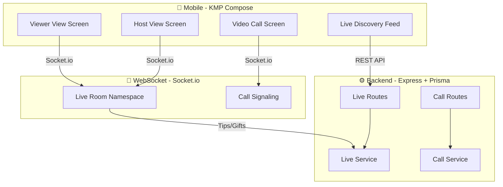

# 🎥 Runinga Live Streaming — Full Implementation Plan

> **Scope**: Live Streaming + Live Commerce + Gamification + Video Calls + Runinga Enhancements  
> **Domains**: Database → Backend → WebSocket → Mobile (KMP Compose)  
> **Estimated Files**: ~80+

---

## Architecture Overview



---

## 📋 Phase 1: Database Schema

### 1.1 Expand LiveSession Model (Currently at Lines 1447-1484)

The current `LiveSession` + `LiveSessionProduct` models are basic (shop-only). We need to massively expand them for full TikTok-style live.

**New/replaced models in `schema.prisma`:**

```prisma
// ─── LIVE STREAMING (FULL) ──────────────────────────────

enum LiveStreamType {
  NORMAL
  CHAMA
  CONTEST_BATTLE
  PROOF_OF_TASK
  COMMERCE
}

enum LiveStreamStatus {
  SCHEDULED
  LIVE
  ENDED
  CANCELLED
}

model LiveStream {
  id              String           @id @default(uuid())
  hostId          String           @map("host_id")
  title           String
  description     String?
  thumbnailUrl    String?          @map("thumbnail_url")
  type            LiveStreamType   @default(NORMAL)
  status          LiveStreamStatus @default(SCHEDULED)
  
  // Stream tech
  streamKey       String           @unique @map("stream_key")
  streamUrl       String?          @map("stream_url")
  playbackUrl     String?          @map("playback_url")
  
  // Stats
  viewerCount     Int              @default(0) @map("viewer_count")
  peakViewers     Int              @default(0) @map("peak_viewers")
  likesCount      Int              @default(0) @map("likes_count")
  totalTipsRc     Decimal          @default(0) @map("total_tips_kr") @db.Decimal(18, 4)
  totalSalesRc    Decimal          @default(0) @map("total_sales_kr") @db.Decimal(18, 4)
  
  // Gift Goals
  giftGoalTitle   String?          @map("gift_goal_title")
  giftGoalTarget  Decimal?         @map("gift_goal_target") @db.Decimal(18, 4)
  giftGoalCurrent Decimal          @default(0) @map("gift_goal_current") @db.Decimal(18, 4)
  
  // Chama-exclusive
  chamaId         String?          @map("chama_id")
  
  // Contest Battle
  contestId       String?          @map("contest_id")
  
  // Proof of Task
  orderId         String?          @map("order_id")
  
  // Duet / Co-host
  isCoHostEnabled Boolean          @default(false) @map("is_co_host_enabled")
  maxCoHosts      Int              @default(1) @map("max_co_hosts")
  
  // Timestamps
  scheduledStart  DateTime?        @map("scheduled_start")
  actualStart     DateTime?        @map("actual_start")
  endedAt         DateTime?        @map("ended_at")
  createdAt       DateTime         @default(now()) @map("created_at")

  host            User             @relation("LiveHost", fields: [hostId], references: [id])
  coHosts         LiveCoHost[]
  viewers         LiveViewer[]
  messages        LiveMessage[]
  tips            LiveTip[]
  pinnedProducts  LivePinnedProduct[]
  battles         LiveBattle[]     @relation("LiveBattleStream")
  battleOpponent  LiveBattle[]     @relation("LiveBattleOpponent")
  
  @@index([status, createdAt])
  @@index([hostId, status])
  @@index([chamaId])
  @@map("live_streams")
}

model LiveCoHost {
  id           String   @id @default(uuid())
  streamId     String   @map("stream_id")
  userId       String   @map("user_id")
  joinedAt     DateTime @default(now()) @map("joined_at")
  leftAt       DateTime? @map("left_at")

  stream LiveStream @relation(fields: [streamId], references: [id], onDelete: Cascade)

  @@unique([streamId, userId])
  @@map("live_co_hosts")
}

model LiveViewer {
  id           String   @id @default(uuid())
  streamId     String   @map("stream_id")
  userId       String   @map("user_id")
  joinedAt     DateTime @default(now()) @map("joined_at")
  leftAt       DateTime? @map("left_at")
  totalTipsRc  Decimal  @default(0) @map("total_tips_kr") @db.Decimal(18, 4)
  likesGiven   Int      @default(0) @map("likes_given")

  stream LiveStream @relation(fields: [streamId], references: [id], onDelete: Cascade)

  @@unique([streamId, userId])
  @@index([streamId, totalTipsKr])
  @@map("live_viewers")
}

model LiveMessage {
  id           String   @id @default(uuid())
  streamId     String   @map("stream_id")
  userId       String   @map("user_id")
  text         String
  isSystem     Boolean  @default(false) @map("is_system")
  isPinned     Boolean  @default(false) @map("is_pinned")
  createdAt    DateTime @default(now()) @map("created_at")

  stream LiveStream @relation(fields: [streamId], references: [id], onDelete: Cascade)

  @@index([streamId, createdAt])
  @@map("live_messages")
}

model LiveTip {
  id           String   @id @default(uuid())
  streamId     String   @map("stream_id")
  senderId     String   @map("sender_id")
  recipientId  String   @map("recipient_id")
  amountRc     Decimal  @map("amount_kr") @db.Decimal(18, 4)
  giftType     String?  @map("gift_type")
  message      String?
  createdAt    DateTime @default(now()) @map("created_at")

  stream LiveStream @relation(fields: [streamId], references: [id], onDelete: Cascade)

  @@index([streamId, createdAt])
  @@index([streamId, senderId])
  @@map("live_tips")
}

model LivePinnedProduct {
  id           String    @id @default(uuid())
  streamId     String    @map("stream_id")
  productId    String    @map("product_id")
  salePrice    Decimal?  @map("sale_price") @db.Decimal(18, 4)
  isPinned     Boolean   @default(false) @map("is_pinned")
  pinnedAt     DateTime? @map("pinned_at")
  unitsSold    Int       @default(0) @map("units_sold")
  sortOrder    Int       @default(0) @map("sort_order")

  stream  LiveStream @relation(fields: [streamId], references: [id], onDelete: Cascade)
  product Product    @relation(fields: [productId], references: [id], onDelete: Cascade)

  @@unique([streamId, productId])
  @@map("live_pinned_products")
}
```

### 1.2 PK Battle Model

```prisma
enum BattleStatus {
  PENDING
  ACTIVE
  COMPLETED
}

model LiveBattle {
  id               String       @id @default(uuid())
  streamId         String       @map("stream_id")
  opponentStreamId String       @map("opponent_stream_id")
  contestId        String?      @map("contest_id")
  durationSecs     Int          @default(300) @map("duration_secs")
  status           BattleStatus @default(PENDING)
  hostScore        Decimal      @default(0) @map("host_score") @db.Decimal(18, 4)
  opponentScore    Decimal      @default(0) @map("opponent_score") @db.Decimal(18, 4)
  winnerId         String?      @map("winner_id")
  startedAt        DateTime?    @map("started_at")
  endedAt          DateTime?    @map("ended_at")
  createdAt        DateTime     @default(now()) @map("created_at")

  stream         LiveStream @relation("LiveBattleStream", fields: [streamId], references: [id], onDelete: Cascade)
  opponentStream LiveStream @relation("LiveBattleOpponent", fields: [opponentStreamId], references: [id], onDelete: Cascade)

  @@map("live_battles")
}
```

### 1.3 Video Call Models

```prisma
enum CallType {
  VOICE
  VIDEO
}

enum CallStatus {
  RINGING
  ACTIVE
  ENDED
  MISSED
  DECLINED
}

model Call {
  id           String     @id @default(uuid())
  chatId       String     @map("chat_id")
  callerId     String     @map("caller_id")
  type         CallType
  status       CallStatus @default(RINGING)
  startedAt    DateTime?  @map("started_at")
  endedAt      DateTime?  @map("ended_at")
  durationSecs Int?       @map("duration_secs")
  createdAt    DateTime   @default(now()) @map("created_at")

  participants CallParticipant[]

  @@index([chatId, createdAt])
  @@index([callerId])
  @@map("calls")
}

model CallParticipant {
  id        String    @id @default(uuid())
  callId    String    @map("call_id")
  userId    String    @map("user_id")
  joinedAt  DateTime? @map("joined_at")
  leftAt    DateTime? @map("left_at")
  status    String    @default("invited")

  call Call @relation(fields: [callId], references: [id], onDelete: Cascade)

  @@unique([callId, userId])
  @@map("call_participants")
}
```

---

## 📋 Phase 2: Backend Services

### 2.1 Live Streaming Module (`backend/src/modules/live/`)

| File | Purpose |
|------|---------|
| `live.routes.ts` | REST endpoints for live management |
| `live.controller.ts` | Request handling |
| `live.service.ts` | Core business logic (create, end, tip, commerce) |
| `live.validation.ts` | Zod schemas |

**Key REST Endpoints:**

| Method | Route | Description |
|--------|-------|-------------|
| `POST` | `/api/v1/live/start` | Start a live stream (creates room, returns stream key) |
| `POST` | `/api/v1/live/:streamId/end` | End live stream |
| `GET` | `/api/v1/live/active` | Get all active live streams (discovery) |
| `GET` | `/api/v1/live/:streamId` | Get stream details |
| `POST` | `/api/v1/live/:streamId/tip` | Send Rc tip (15% platform cut via WalletService) |
| `POST` | `/api/v1/live/:streamId/like` | Send likes |
| `GET` | `/api/v1/live/:streamId/leaderboard` | Top gifters |
| `POST` | `/api/v1/live/:streamId/pin-product` | Pin product to stream |
| `DELETE` | `/api/v1/live/:streamId/pin-product/:productId` | Unpin product |
| `POST` | `/api/v1/live/:streamId/co-host/invite` | Invite co-host |
| `POST` | `/api/v1/live/:streamId/battle/start` | Start PK battle |
| `POST` | `/api/v1/live/:streamId/gift-goal` | Set/update gift goal |
| `GET` | `/api/v1/live/chama/:chamaId` | Get chama-exclusive live |

### 2.2 Live Socket.io Events (`shared/gateway/live-socket.ts`)

**Client → Server:**

| Event | Payload | Description |
|-------|---------|-------------|
| `live:join` | `{ streamId }` | Join live room |
| `live:leave` | `{ streamId }` | Leave live room |
| `live:message` | `{ streamId, text }` | Send chat message |
| `live:tip` | `{ streamId, recipientId, amountKr, giftType }` | Send tip/gift |
| `live:like` | `{ streamId, count }` | Batch likes (rapid taps) |
| `live:pin_product` | `{ streamId, productId }` | Host pins product |
| `live:battle_accept` | `{ battleId }` | Accept PK battle invite |

**Server → Client:**

| Event | Description |
|-------|-------------|
| `live:viewer_joined` | "@username joined" system alert |
| `live:viewer_left` | Viewer departed |
| `live:new_message` | New chat bubble |
| `live:tip_received` | Tip + animation type trigger |
| `live:like_burst` | Heart animation burst data |
| `live:viewer_count` | Updated count |
| `live:leaderboard_update` | Top gifters refresh |
| `live:product_pinned` | Product card overlay |
| `live:gift_goal_update` | Progress bar update |
| `live:battle_update` | Score change |
| `live:battle_ended` | Final result |
| `live:co_host_joined` | Split-screen trigger |
| `live:stream_ended` | Stream finished |

### 2.3 Video Call Module (`backend/src/modules/calls/`)

| File | Purpose |
|------|---------|
| `calls.routes.ts` | REST endpoints |
| `calls.controller.ts` | Request handling |
| `calls.service.ts` | Call lifecycle logic |
| `calls.validation.ts` | Zod schemas |

**Endpoints:**

| Method | Route | Description |
|--------|-------|-------------|
| `POST` | `/api/v1/calls/initiate` | Start a call |
| `POST` | `/api/v1/calls/:callId/answer` | Answer call |
| `POST` | `/api/v1/calls/:callId/decline` | Decline call |
| `POST` | `/api/v1/calls/:callId/end` | End call |
| `GET` | `/api/v1/calls/history/:chatId` | Call history |

### 2.4 Call Signaling Events (`shared/gateway/call-socket.ts`)

| Event | Direction | Description |
|-------|-----------|-------------|
| `call:incoming` | S→C | Incoming call push |
| `call:offer` | C→S→C | WebRTC SDP offer relay |
| `call:answer` | C→S→C | WebRTC SDP answer relay |
| `call:ice_candidate` | C→S→C | ICE candidate relay |
| `call:declined` | S→C | Call declined |
| `call:ended` | S→C | Call ended |
| `call:participant_joined` | S→C | Group: new participant |
| `call:participant_left` | S→C | Group: participant left |

---

## 📋 Phase 3: Mobile Frontend

### 3.1 Navigation Changes

**HomeScreen tabs** updated:
```
Current:  Contests | Discover | Admiring
New:      Live | Contests | Discover | Admiring
```

Default tab stays on **Discover** (index 2).

### 3.2 Module: `feature/live/`

```
feature/live/
├── data/
│   ├── model/
│   │   ├── LiveStreamDto.kt
│   │   ├── LiveMessageDto.kt
│   │   ├── LiveTipDto.kt
│   │   └── LiveBattleDto.kt
│   └── repository/
│       └── LiveRepositoryImpl.kt
├── di/
│   └── LiveModule.kt
├── domain/
│   ├── model/
│   │   ├── LiveStream.kt
│   │   ├── LiveMessage.kt
│   │   └── LiveBattle.kt
│   └── repository/
│       └── LiveRepository.kt
└── presentation/
    ├── screen/
    │   ├── LiveFeedScreen.kt        // Grid/list of active lives
    │   ├── GoLiveScreen.kt          // Pre-live setup
    │   ├── HostLiveScreen.kt        // Host broadcasting UI
    │   ├── ViewerLiveScreen.kt      // Viewer watching UI
    │   └── LiveCommerceSheet.kt     // Product basket
    └── viewmodel/
        ├── LiveFeedViewModel.kt
        ├── HostLiveViewModel.kt
        └── ViewerLiveViewModel.kt
```

### 3.3 Module: `feature/calls/`

```
feature/calls/
├── data/
│   ├── model/CallDto.kt
│   └── repository/CallRepositoryImpl.kt
├── di/
│   └── CallModule.kt
├── domain/
│   ├── model/Call.kt
│   └── repository/CallRepository.kt
└── presentation/
    ├── screen/
    │   ├── IncomingCallScreen.kt
    │   ├── ActiveCallScreen.kt
    │   └── GroupCallScreen.kt
    └── viewmodel/
        └── CallViewModel.kt
```

### 3.4 Screen Designs

#### Host View
```
┌─────────────────────────────┐
│ 👤 Host  │  ⏱ 12:34  │ 👁 1.2K│
│                              │
│    [Camera Feed - Full]      │
│                              │
│    ┌──────────────────┐      │
│    │ 🎁 Gift Goal     │      │
│    │ ████████░░ 8K/10K │      │
│    └──────────────────┘      │
│                              │
│  💬 Chat Messages (scroll)   │
│  ├── @user1: Great show!     │
│  ├── @user2 joined           │
│  └── 💸 @user3 sent 50 Rc!  │
│                              │
│ [Comment] [🛒] [🎁] [⚙️]   │
└─────────────────────────────┘
```

#### Viewer View
```
┌─────────────────────────────┐
│ 👤 Host  │ 👁 1.2K │ 🏆 Top3│
│                              │
│    [Live Video - Full]       │
│                         ❤️   │
│                         ❤️   │
│  ┌──────────────────┐   ❤️   │
│  │ 🛒 Pinned Product │       │
│  │ Nike Air Max 120Kr│       │
│  │     [Buy Now]     │       │
│  └──────────────────┘        │
│                              │
│  💬 Chat Messages            │
│ [Comment] [Share] [🎁 Gift] │
└─────────────────────────────┘
```

#### PK Battle Split Screen
```
┌──────────┬──────────┐
│ Host A   │ Host B   │
│ Score:850│ Score:720│
│ ████████████░░░░░░  │
├──────────┼──────────┤
│ [Video]  │ [Video]  │
├──────────┴──────────┤
│ 💬 Chat  [🎁 Tip]  │
└─────────────────────┘
```

---

## 📋 Phase 4: Gamification

### 4.1 Virtual Gift Catalog

| Gift | Rc Cost | Animation Level |
|------|---------|-----------------|
| 🌹 Rose | 1 Rc | Small float-up |
| ⭐ Star | 5 Rc | Medium sparkle |
| 🚀 Rocket | 50 Rc | Screen fly-across |
| 🎆 Fireworks | 100 Rc | Full screen takeover |
| 👑 Crown | 500 Rc | Crown drop on host |
| 🏰 Castle | 1000 Rc | Epic full-screen |

### 4.2 Features
- **Tap-to-Like**: Rapid tapping → animated hearts float up right edge
- **Gift Goals**: Progress bar toward a Rc target
- **Viewer Leaderboard**: Top 3-5 gifters pinned at top
- **Entrance Animations**: Top gifters get special join alerts
- **PK Battle Timer**: 5-minute countdown + tug-of-war bar

---

## 📋 Phase 5: Runinga-Specific Enhancements

### 5.1 Chama Live
- Chama leaders start `CHAMA` type streams
- Only chama members can view (middleware enforced)
- Pinned ledger showing contribution progress
- Can trigger Merry-Go-Round payout during live

### 5.2 Live Contest Battles
- Two contestants go live split-screen for a Contest
- Viewer tips count as contest "votes"
- Winner advances on the Contest leaderboard

### 5.3 Direct Rc Commerce
- Tips use universal `WalletService.sendTip()` (15% platform cut)
- Shoppable basket uses existing Cart/Order/Escrow system
- Viewers commit Rc into Escrow → item secured during stream

### 5.4 Proof of Task
- Service providers stream `PROOF_OF_TASK` linked to an Order
- Stream end → Order marked `DELIVERED`
- Escrow auto-released

---

## 📋 Task Execution Order

| # | Task | Dependencies |
|---|------|-------------|
| **1** | Expand Prisma schema: LiveStream, LiveCoHost, LiveViewer, LiveMessage, LiveTip, LivePinnedProduct, LiveBattle, Call, CallParticipant | — |
| **2** | Remove old LiveSession/LiveSessionProduct, update User model relations | 1 |
| **3** | `prisma generate` + `prisma db push` | 2 |
| **4** | Backend: `live.validation.ts` | — |
| **5** | Backend: `live.service.ts` | 3, 4 |
| **6** | Backend: `live.controller.ts` | 5 |
| **7** | Backend: `live.routes.ts` | 6 |
| **8** | Backend: `live-socket.ts` (Socket.io live room namespace) | 5 |
| **9** | Backend: `calls.validation.ts` | — |
| **10** | Backend: `calls.service.ts` | 3, 9 |
| **11** | Backend: `calls.controller.ts` | 10 |
| **12** | Backend: `calls.routes.ts` | 11 |
| **13** | Backend: `call-socket.ts` (WebRTC signaling) | 10 |
| **14** | Register routes + socket namespaces in `index.ts` | 7, 8, 12, 13 |
| **15** | Update `events.ts` with live + call events | 8, 13 |
| **16** | Mobile: Live DTOs + domain models | — |
| **17** | Mobile: `LiveRepository` interface + impl | 16 |
| **18** | Mobile: `LiveModule` (Koin DI) | 17 |
| **19** | Mobile: `LiveFeedViewModel` | 17 |
| **20** | Mobile: `LiveFeedScreen` | 19 |
| **21** | Mobile: `GoLiveScreen` (pre-broadcast setup) | 18 |
| **22** | Mobile: `HostLiveViewModel` | 17 |
| **23** | Mobile: `HostLiveScreen` | 22 |
| **24** | Mobile: `ViewerLiveViewModel` | 17 |
| **25** | Mobile: `ViewerLiveScreen` | 24 |
| **26** | Mobile: `LiveCommerceSheet` | 17 |
| **27** | Mobile: Call DTOs + domain models | — |
| **28** | Mobile: `CallRepository` interface + impl | 27 |
| **29** | Mobile: `CallModule` (Koin DI) | 28 |
| **30** | Mobile: `CallViewModel` | 28 |
| **31** | Mobile: `IncomingCallScreen` | 30 |
| **32** | Mobile: `ActiveCallScreen` | 30 |
| **33** | Mobile: `GroupCallScreen` | 30 |
| **34** | Update `HomeScreen.kt`: Add "Live" tab (index 0) | 20 |
| **35** | Update chat room: Add video/voice call buttons | 31 |
| **36** | Update `MainScreen.kt` CreateBottomSheet: Add "Go Live" option | 21 |
| **37** | Wire DI modules in app-level Koin config | 18, 29 |

---

## 🛑 Questions Before Implementation

> [!IMPORTANT]
> Please answer these before I start coding:

1. **WebRTC Provider**: Should we use a managed media server (Agora, LiveKit, Mux) or pure WebRTC signaling for now?

2. **Group Call Max Size**: Maximum participants in group calls? (affects mesh vs SFU topology)

3. **VOD Replays**: Should ended streams be saved as VODs for replay?

4. **Moderation Tools**: Should hosts be able to ban/mute viewers? Word filters in live chat?

5. **Go-Live Requirements**: Minimum follower count to go live, or anyone can?
